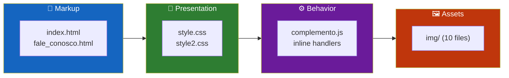
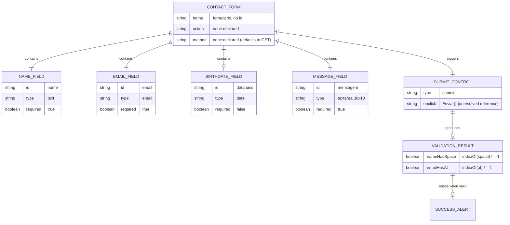
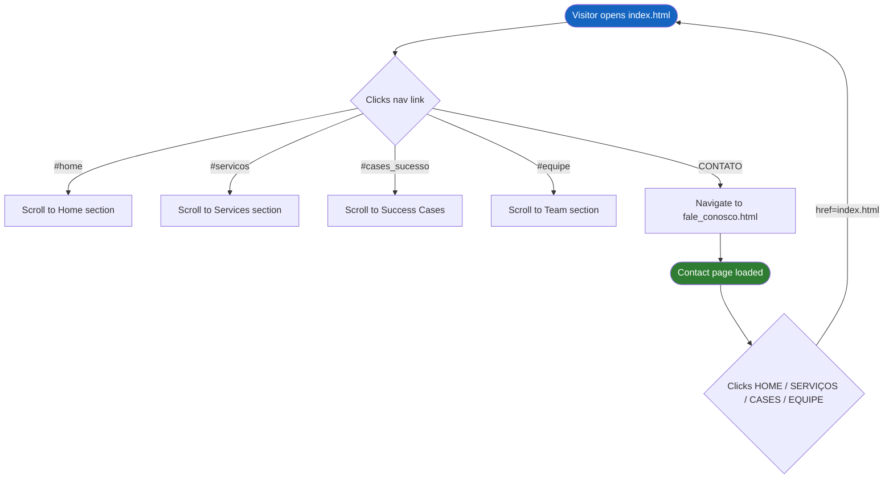
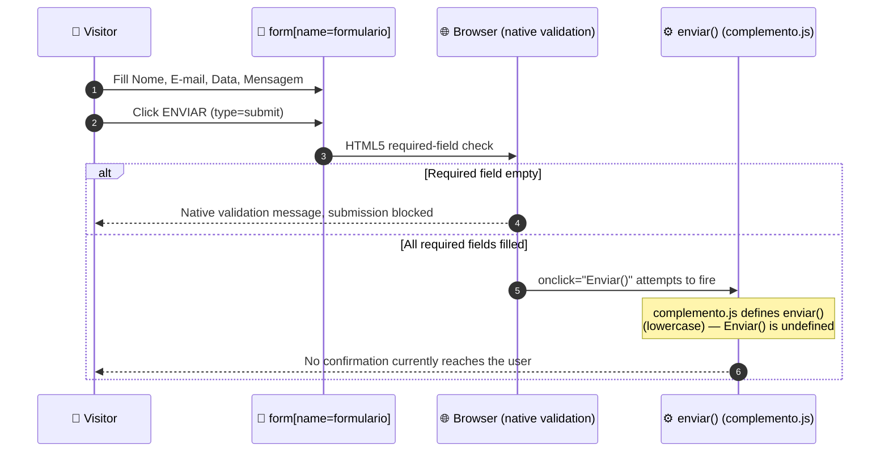
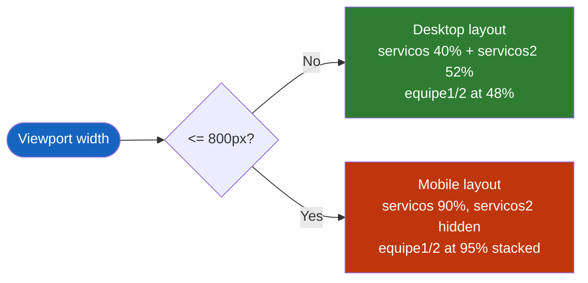
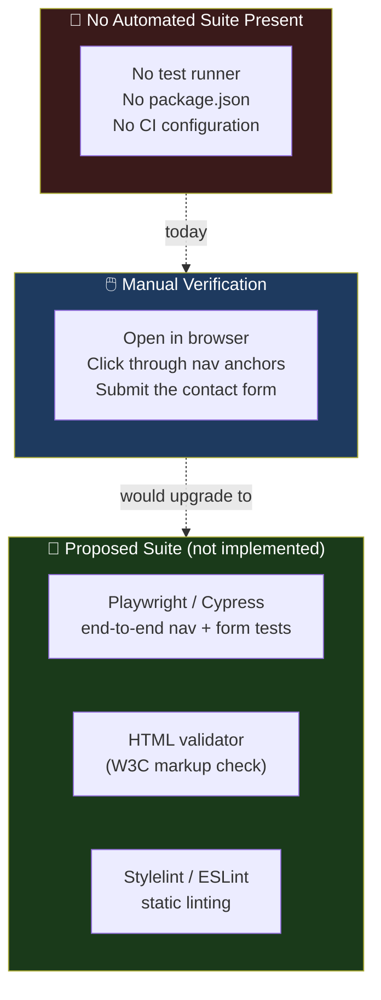

<div align="center">

**🌐 Choose Language / Selecione o Idioma / Elija el Idioma**

[](README.md)&nbsp;&nbsp;&nbsp;[](README_PT.md)&nbsp;&nbsp;&nbsp;[](README_ES.md)

</div>

---

<div align="center">

```
████████╗██████╗  █████╗ ██████╗  █████╗ ██╗     ██╗  ██╗ ██████╗ ███████╗
╚══██╔══╝██╔══██╗██╔══██╗██╔══██╗██╔══██╗██║     ██║  ██║██╔═══██╗██╔════╝
   ██║   ██████╔╝███████║██████╔╝███████║██║     ███████║██║   ██║███████╗
   ██║   ██╔══██╗██╔══██║██╔══██╗██╔══██║██║     ██╔══██║██║   ██║╚════██║
   ██║   ██║  ██║██║  ██║██████╔╝██║  ██║███████╗██║  ██║╚██████╔╝███████║
   ╚═╝   ╚═╝  ╚═╝╚═╝  ╚═╝╚═════╝ ╚═╝  ╚═╝╚══════╝╚═╝  ╚═╝ ╚═════╝ ╚══════╝
              DO-CURSO — Static HTML/CSS/JS Course Coursework Site
```

---

[](https://developer.mozilla.org/docs/Web/HTML)
[](https://developer.mozilla.org/docs/Web/CSS)
[](https://developer.mozilla.org/docs/Web/JavaScript)
[]()
[]()
[]()

<br/>

> **A static, dependency-free multi-page website for a fictional information-security company**
> built as web-development coursework, demonstrating raw HTML structure, CSS layout, and vanilla JS form handling.

<br/>


</div>

---

## 📑 Table of Contents

<details>
<summary>▶️ <strong>Click to expand / collapse this section</strong></summary>

<table>
<tr>
<td valign="top" width="50%">

**🏗️ System**
- [Overview](#-overview)
- [System Architecture](#-system-architecture)
- [Technology Stack](#-technology-stack)
- [Design Patterns](#-design-patterns-applied)
- [Project Structure](#-project-structure)

**📦 Modules**
- [Header & Navigation](#-header--navigation)
- [Home Section](#-home-section)
- [Services Section](#-services-section)
- [Success Cases Section](#-success-cases-section)
- [Team Section](#-team-section)
- [Contact Page](#-contact-page)
- [Footer](#-footer)

</td>
<td valign="top" width="50%">

**💼 Business**
- [Business Rules](#-business-rules)
- [Functional Requirements](#-functional-requirements)
- [Non-Functional Requirements](#-non-functional-requirements)

**📐 Design**
- [Data Model](#-data-model)
- [System Flows](#-system-flows)

**🔐 Security & Ops**
- [Security](#-security)
- [Installation & Execution](#-installation--execution)
- [Automated Tests](#-automated-tests)
- [Metrics & Monitoring](#-metrics--monitoring)
- [Known Limitations](#-known-limitations)

</td>
</tr>
</table>

---

</details>

## 🌟 Overview

<details>
<summary>▶️ <strong>Click to expand / collapse this section</strong></summary>

**Trabalhos-do-Curso** hosts the coursework produced for a web-development class: a two-page static site for **SECURITY HELP**, a fictional information-security consultancy. The site is written by hand in plain **HTML5**, **CSS3**, and **vanilla JavaScript**, with no framework, bundler, package manager, or server-side code of any kind.

The home page (`index.html`) is a single long scrolling document split into anchor-addressed sections (Home, Services, Success Cases, Team) reached from a fixed navigation bar. A second page (`fale_conosco.html`) hosts a contact form with simple client-side validation. The repository also contains a `trabalho_des_web.zip` archive, which is the packaged deliverable submitted for grading, and three placeholder `new.txt` files that mark otherwise-empty asset folders in the version-controlled tree.

Because the project is coursework, the "business" it documents (SECURITY HELP, its 37 listed employees, its testimonials) is fictional content authored to satisfy an assignment brief. This README treats it as any other software artifact: the structure, styling, and interactivity are real and are documented as built.

### 🎯 System Objectives

| Objective | Description |
|-----------|-------------|
| 🏠 **Landing Page** | Present the fictional company on a single scrollable `index.html` |
| 🧭 **Anchor Navigation** | Let visitors jump to `#home`, `#servicos`, `#cases_sucesso`, `#equipe` from a fixed header |
| 🛡️ **Service Catalog** | Describe four information-security service lines in a bulleted list |
| ⭐ **Social Proof** | Showcase five client testimonials under "Cases de Sucesso" |
| 👥 **Team Directory** | List the fictional staff roster across two columns |
| 📨 **Contact Form** | Collect name, e-mail, birth date, and message on `fale_conosco.html` |
| 🎨 **Responsive Layout** | Adapt the team and services columns for viewports under 800px |
| 🔗 **Social Links** | Point to Facebook, Instagram, and WhatsApp from the footer |

---

</details>

## 🏗️ System Architecture

<details>
<summary>▶️ <strong>Click to expand / collapse this section</strong></summary>

### Module Diagram

```mermaid
flowchart TB
    subgraph PAGES["📄  HTML PAGES"]
        direction LR
        HOME["🏠 index.html\n─────────────\nHeader + nav\nHome / Services\nCases / Team\nFooter"]
        CONTACT["📨 fale_conosco.html\n─────────────\nHeader + nav\nContact <form>\nInline <script>\nFooter"]
    end

    subgraph STYLE["🎨  PRESENTATION"]
        direction LR
        S1["style.css\n─────────────\nGlobal layout\nNav · sections\nMedia query <800px"]
        S2["style2.css\n─────────────\nForm-only rules\nfale_conosco.html"]
    end

    subgraph SCRIPT["⚙️  BEHAVIOR"]
        JS["complemento.js\n─────────────\nenviar()\nName + e-mail\nclient validation"]
        INLINE["inline <script>\n─────────────\nenviarFormulario()\nform.reset()"]
    end

    subgraph ASSETS["🖼️  STATIC ASSETS"]
        direction LR
        IMG["img/\n─────────────\nlogo · home\nservicos · cases\nequipe1-2\nsocial icons"]
    end

    subgraph DELIV["📦  DELIVERABLE"]
        ZIP["trabalho_des_web.zip\n─────────────\nGraded submission\narchive"]
    end

    HOME -->|"href=css/style.css"| S1
    CONTACT -->|"href=css/style.css"| S1
    CONTACT -->|"href=css/style2.css"| S2
    HOME -.->|"stylesheet tag (mislinked)"| JS
    CONTACT -->|"link text/javascript"| JS
    CONTACT --> INLINE
    HOME --> IMG
    CONTACT --> IMG
    HOME -.->|"packaged into"| ZIP
    CONTACT -.->|"packaged into"| ZIP

    style PAGES fill:#1e3a5f,color:#fff,stroke:#4a90d9
    style STYLE fill:#1a3a1a,color:#fff,stroke:#4caf50
    style SCRIPT fill:#3a1a1a,color:#fff,stroke:#e57373
    style ASSETS fill:#3a2a1a,color:#fff,stroke:#ffb74d
    style DELIV fill:#2a1a3a,color:#fff,stroke:#ce93d8
```



### Architecture Layers



There is no server tier, no database, and no build step: a browser requests `index.html` (or `fale_conosco.html`) directly from a file server, and the HTML document pulls its stylesheet(s) and script via plain `<link>`/`<script>` tags.

---

</details>

## 🛠️ Technology Stack

<details>
<summary>▶️ <strong>Click to expand / collapse this section</strong></summary>

<table>
<thead>
<tr>
<th>Layer</th>
<th>Technology</th>
<th>Version</th>
<th>Purpose</th>
</tr>
</thead>
<tbody>
<tr>
<td rowspan="1"><strong>📄 Markup</strong></td>
<td>HTML</td>
<td>5 (<code>&lt;!DOCTYPE html&gt;</code>)</td>
<td><code>index.html</code>, <code>fale_conosco.html</code> — two hand-written documents</td>
</tr>
<tr>
<td rowspan="2"><strong>🎨 Styling</strong></td>
<td>CSS</td>
<td>3</td>
<td><code>css/style.css</code> (global) + <code>css/style2.css</code> (form page)</td>
</tr>
<tr>
<td>Media Queries</td>
<td>—</td>
<td><code>@media(max-width:800px)</code> responsive breakpoint</td>
</tr>
<tr>
<td rowspan="2"><strong>⚙️ Scripting</strong></td>
<td>JavaScript</td>
<td>ES5-style, no modules</td>
<td><code>js/complemento.js</code> — <code>enviar()</code> form check</td>
</tr>
<tr>
<td>Inline <code>&lt;script&gt;</code></td>
<td>—</td>
<td><code>fale_conosco.html</code> head — <code>enviarFormulario()</code></td>
</tr>
<tr>
<td rowspan="1"><strong>🖼️ Assets</strong></td>
<td>PNG / JPG</td>
<td>—</td>
<td>10 files under <code>img/</code>: logo, hero photos, icons</td>
</tr>
<tr>
<td rowspan="1"><strong>📦 Packaging</strong></td>
<td>ZIP archive</td>
<td>—</td>
<td><code>trabalho_des_web.zip</code> — the graded coursework submission</td>
</tr>
<tr>
<td rowspan="1"><strong>🔧 Tooling</strong></td>
<td>None</td>
<td>—</td>
<td>No package manager, bundler, transpiler, or build script is present</td>
</tr>
</tbody>
</table>

---

</details>

## 🎨 Design Patterns Applied

<details>
<summary>▶️ <strong>Click to expand / collapse this section</strong></summary>

| Pattern | Where | Rationale |
|---------|-------|-----------|
| 🧭 **Fragment Navigation** | `<a class="menu" href="#servicos">` etc. | Single-page anchor jumps avoid extra page loads for related content |
| 🗂️ **Section-as-Component** | `<div class="img_home">`, `.img_servicos`, `.img_cases_sucesso`, `.equipe` | Each visual block is a self-contained markup + CSS-class pair |
| 🎭 **Background-Image Wrapper** | `.img_home`, `.img_servicos`, `.img_cases_sucesso` | An outer `div` supplies the full-bleed photo; an inner `div` holds readable text |
| 📐 **Two-Column Split** | `.equipe1` / `.equipe2` (float-based) | The 37-person roster is balanced across two floated lists |
| 📱 **Progressive Enhancement (breakpoint)** | `@media(max-width:800px)` in `style.css` | Team and services columns collapse to full width on small screens |
| ✅ **Guard-Clause Validation** | `enviar()` in `complemento.js` | Nested `if` checks reject empty or malformed input before alerting success |
| 🏷️ **Semantic Landmarks** | `<header>`, `<nav>`, `<footer>` | Native HTML5 landmark elements frame the page instead of generic `div`s |

---

</details>

## 📁 Project Structure

<details>
<summary>▶️ <strong>Click to expand / collapse this section</strong></summary>

```
Trabalhos-do-Curso/
│
├── 📄 index.html                # Home page: header/nav + Home, Services, Cases, Team, footer
├── 📄 fale_conosco.html         # Contact page: header/nav + <form> + inline <script>
├── 📄 trabalho_des_web.zip      # Packaged deliverable submitted for grading
├── 📄 .gitignore                # Secrets/build-artifact ignore rules (generic template)
│
├── 📂 css/
│   ├── 📄 style.css             # Global layout: nav, sections, footer, responsive breakpoint
│   ├── 📄 style2.css            # Contact-form-only rules (loaded by fale_conosco.html)
│   └── 📄 new.txt               # Placeholder keeping the folder tracked in Git
│
├── 📂 js/
│   ├── 📄 complemento.js        # enviar(): name + e-mail client-side validation
│   └── 📄 new.txt               # Placeholder keeping the folder tracked in Git
│
├── 📂 img/
│   ├── 🖼️ logo.png              # Site logo, used in header and footer
│   ├── 🖼️ home.jpg              # Hero background for the Home section
│   ├── 🖼️ servicos.png          # Illustration beside the Services list
│   ├── 🖼️ cases_sucesso.jpg     # Background for the Success Cases section
│   ├── 🖼️ cases1.png            # Case-study supporting image
│   ├── 🖼️ cases2.jpg            # Case-study supporting image
│   ├── 🖼️ cases3.jpg            # Case-study supporting image
│   ├── 🖼️ equipe1.jpg           # Team section supporting image
│   ├── 🖼️ equipe2.jpg           # Team section supporting image
│   ├── 🖼️ facebook.png          # Footer social icon
│   ├── 🖼️ instagram.png         # Footer social icon
│   ├── 🖼️ whatsapp.png          # Footer social icon
│   └── 📄 new.txt               # Placeholder keeping the folder tracked in Git
│
├── 📄 README.md                 # 🇺🇸 English (primary)
├── 📄 README_PT.md              # 🇧🇷 Português
└── 📄 README_ES.md              # 🇪🇸 Español
```

---

</details>

## 📦 System Modules

<details>
<summary>▶️ <strong>Click to expand / collapse this section</strong></summary>

### 🧭 Header & Navigation

Present identically at the top of both pages. A `<header><nav>` wraps a `div.navegacao` containing the logo image and four or five anchor links.

| Element | `index.html` | `fale_conosco.html` |
|---------|--------------|----------------------|
| Logo | `` | `` |
| HOME | `href="#home"` | `href="index.html"` |
| SERVIÇOS | `href="#servicos"` | `href="index.html"` |
| CASES DE SUCESSO | `href="#cases_sucesso"` | `href="index.html"` |
| EQUIPE | `href="#equipe"` | `href="index.html"` |
| CONTATO | `href="fale_conosco.html"` | `href="#contato"` |

> [!NOTE]
> On `fale_conosco.html` the CONTATO link points to `#contato`, but no element in that file carries `id="contato"` — the anchor currently resolves to the top of the page.

---

### 🏠 Home Section

`div.img_home` (full-bleed background from `img/home.jpg`, fixed attachment) wraps `div.home#home`, which holds an `<h1>APRESENTAÇÃO</h1>` and one justified paragraph introducing SECURITY HELP: founded in Irati-PR, five branch offices across Paraná, over 20 years in the market.

---

### 🛠️ Services Section

`div.img_servicos` lays out `div.servicos#servicos` (40% width, inline-block) beside `div.servicos2` (an absolutely positioned image panel showing `img/servicos.png`). The services list (`<ul><li>`) enumerates four offerings:

| # | Service | Summary |
|---|---------|---------|
| 1 | Vulnerability Analysis in IT | Scans devices/networks for weaknesses, using techniques such as penetration testing |
| 2 | Information Security Policies | LGPD-compliant handling, ISO 27001 and ISO 27002 certifications cited |
| 3 | Data Recovery | Backup & Business Continuity Plan: 3 backups across 2 different media |
| 4 | Team Training & Certification | Certification and training aligned with LGPD, ISO 27001/27002 |

---

### ⭐ Success Cases Section

`div.img_cases_sucesso` (background `img/cases_sucesso.jpg`) wraps `div.cases_sucesso#cases_sucesso`, containing an `<h1>` and five `<h4>`/`<p>` testimonial pairs from fictional clients, plus a closing paragraph claiming over 350 partner companies.

| Client | Domain |
|--------|--------|
| Banco Socorro | Banking |
| Ministério Público | Public sector |
| Só Fast, Só Food | Food delivery |
| FlashSpeed | Urban mobility |
| ChatBook | Messaging/social |

---

### 👥 Team Section

`div.equipe#equipe` (light background, dark text via inline overrides) holds an intro paragraph followed by two floated unordered lists, `equipe1` and `equipe2`, each roughly 18-19 `<li>` entries of `Name - ROLE`, for **37 named staff** across roles like Security Analyst, Network Engineer, Cybersecurity Consultant. A closing paragraph states the company employs 100 people in total.

---

### 📨 Contact Page

`fale_conosco.html` reuses the same header/nav, then presents a bare `<form name="formulario">` (no `id`, no `action`, no `method`) with four fields.

| Field | Input type | Required | Notes |
|-------|-----------|----------|-------|
| `nome` | `text` | ✅ | Full name |
| `email` | `email` | ✅ | Browser-native e-mail format check |
| `datanasc` | `date` | — | Birth date, optional, `id` referenced but no `for` match on the label |
| `mensagem` | `textarea` (30×10) | ✅ | Free-text message |
| submit | `input[type=submit]` | — | `onclick="Enviar()"` (capital E — does not match any defined function) |

The document also declares an inline `<script>` with `enviarFormulario()`, which resets `#meuFormulario` (an id the form does not actually carry) and calls a malformed `document.getElementById(...).prompt(...)` line. Neither this inline function nor `Enviar()` (capitalized) is ever successfully invoked by the current markup; see [Known Limitations](#-known-limitations).

---

### 🦶 Footer

Present on both pages: an `<h3>CONTATOS E REDES SOCIAIS</h3>` heading followed by `div.rodape` with Facebook, Instagram, and WhatsApp icon links, plus a Flaticon attribution link wrapping the logo image (satisfying the icon license).

---

</details>

## 💼 Business Rules

<details>
<summary>▶️ <strong>Click to expand / collapse this section</strong></summary>

### 📝 Content Rules

| # | Rule | Enforcement |
|---|------|-------------|
| BR-01 | The site presents exactly one fictional company, SECURITY HELP | Single brand across both pages, one logo, one color scheme |
| BR-02 | Navigation targets on the home page are same-page anchors | `href="#home"`, `#servicos`, `#cases_sucesso`, `#equipe` |
| BR-03 | Navigation targets on the contact page point back to the home page | `href="index.html"` for HOME/SERVIÇOS/CASES/EQUIPE |
| BR-04 | Every services entry names a security discipline and a one-paragraph justification | Four `<li>` entries in `#servicos` |
| BR-05 | Every testimonial is attributed to a named fictional client | Five `<h4>`/`<p>` pairs in `#cases_sucesso` |
| BR-06 | The team roster is split into two visually balanced columns | `equipe1` (float:left) / `equipe2` (float:right), each ~48% width |

### ✉️ Form Rules

| # | Rule | Enforcement |
|---|------|-------------|
| BR-07 | A submission must include a full name containing at least one space | `nome.value != "" && nome.value.indexOf(" ") != -1` in `enviar()` |
| BR-08 | A submission must include an `@` character in the e-mail field | `email.value.indexOf("@") != -1` in `enviar()` |
| BR-09 | The name and e-mail fields are marked `required` at the HTML level | Browser blocks submission before JS runs if empty |
| BR-10 | A successful client-side check surfaces a native `alert()` | `alert("ENVIADO COM SUCESSO! Agradecemos a mensagem!")` |

### 📐 Layout Rules

| # | Rule | Enforcement |
|---|------|-------------|
| BR-11 | Below 800px viewport width, multi-column sections collapse to near-full width | `@media(max-width:800px)` in `style.css` |
| BR-12 | The services illustration is hidden entirely on narrow viewports | `div.servicos2 { width: 0; height: 0; overflow: hidden; }` inside the breakpoint |

---

</details>

## ✅ Functional Requirements

<details>
<summary>▶️ <strong>Click to expand / collapse this section</strong></summary>

| ID | Requirement | Priority | Status |
|----|-------------|----------|--------|
| **RF-01** | The system shall render a home page reachable at `index.html` | 🔴 High | ✅ Implemented |
| **RF-02** | The system shall provide a fixed navigation bar with logo and menu links | 🔴 High | ✅ Implemented |
| **RF-03** | The system shall let the visitor jump to the Home section via anchor | 🟡 Medium | ✅ Implemented |
| **RF-04** | The system shall let the visitor jump to the Services section via anchor | 🟡 Medium | ✅ Implemented |
| **RF-05** | The system shall let the visitor jump to the Success Cases section via anchor | 🟡 Medium | ✅ Implemented |
| **RF-06** | The system shall let the visitor jump to the Team section via anchor | 🟡 Medium | ✅ Implemented |
| **RF-07** | The system shall list at least four security service offerings | 🔴 High | ✅ Implemented |
| **RF-08** | The system shall display at least five client testimonials | 🟡 Medium | ✅ Implemented |
| **RF-09** | The system shall list the company's staff roster in two columns | 🟢 Low | ✅ Implemented |
| **RF-10** | The system shall link to Facebook, Instagram, and WhatsApp in the footer | 🟢 Low | ✅ Implemented |
| **RF-11** | The system shall provide a dedicated contact page with a form | 🔴 High | ✅ Implemented |
| **RF-12** | The contact form shall collect full name, e-mail, birth date, and message | 🔴 High | ✅ Implemented |
| **RF-13** | The contact form shall reject submission of an empty required field at the HTML level | 🟡 Medium | ✅ Implemented |
| **RF-14** | The contact form shall validate that the name contains a space (first + last) | 🟡 Medium | ⚠️ Partial |
| **RF-15** | The contact form shall validate that the e-mail contains an `@` | 🟡 Medium | ⚠️ Partial |
| **RF-16** | The contact form shall confirm successful submission to the user | 🟡 Medium | ⚠️ Partial |
| **RF-17** | The contact form shall clear its fields after a successful submission | 🟢 Low | ⚠️ Partial |
| **RF-18** | The layout shall adapt to viewports narrower than 800px | 🟡 Medium | ✅ Implemented |
| **RF-19** | The system shall attribute the icon set to its source (Flaticon) | 🟢 Low | ✅ Implemented |
| **RF-20** | The repository shall include a packaged submission archive | 🟢 Low | ✅ Implemented |

---

</details>

## ⚡ Non-Functional Requirements

<details>
<summary>▶️ <strong>Click to expand / collapse this section</strong></summary>

| ID | Category | Requirement | Target |
|----|----------|-------------|--------|
| **RNF-01** | ⚡ Performance | No external HTTP requests beyond same-origin assets | Zero third-party network calls |
| **RNF-02** | 📦 Footprint | Total page weight excluding the zip archive | A few hundred KB of images + text |
| **RNF-03** | 🌐 Compatibility | Renders in any modern evergreen browser | No vendor-prefixed CSS required |
| **RNF-04** | 📱 Responsiveness | Layout usable down to a single breakpoint | `@media(max-width:800px)` |
| **RNF-05** | 🎨 Consistency | Header/nav/footer markup identical across pages | Manual duplication, kept in sync by hand |
| **RNF-06** | ♿ Accessibility | Images carry `alt` text | Present but generic (`alt="icon"`) on several images |
| **RNF-07** | 🌍 Internationalization | Content language | Portuguese (Brazil), `lang="pt-BR"` on both documents |
| **RNF-08** | 🔧 Maintainability | No build tooling required to edit or preview | Open the `.html` file directly in a browser |
| **RNF-09** | 🔐 Privacy | No cookies, no analytics, no tracking script | Static markup only |
| **RNF-10** | 🧪 Testability | Manually verifiable in a browser without setup | No automated harness present |
| **RNF-11** | 📐 Portability | No absolute paths, no server dependency | Relative `href`/`src` throughout |
| **RNF-12** | 🗄️ Versioning | Empty asset folders remain tracked in Git | `new.txt` placeholders in `css/`, `js/`, `img/` |

---

</details>

## 🗄️ Data Model

<details>
<summary>▶️ <strong>Click to expand / collapse this section</strong></summary>

The project has no database or backend; the "data model" here is the shape of the **DOM state and the in-browser form payload** that `complemento.js` and the inline script operate on.

### Entity-Relationship Diagram



### Static Content Shape (Team Roster / Testimonials)

Since there is no database, the site's content is instead hard-coded into `index.html` as repeated markup blocks. The effective "schema" each entry follows is:

| Collection | Row shape | Count |
|------------|-----------|-------|
| Team roster (`equipe1`) | `Name - ROLE_IN_UPPERCASE` `<li>` text | ~19 |
| Team roster (`equipe2`) | `Name - ROLE_IN_UPPERCASE` `<li>` text | ~18 |
| Testimonials | `<h4>Client Name</h4>` + `<p>Quote</p>` | 5 |
| Services | `<li>TITLE: description</li>` | 4 |

---

</details>

## 🔄 System Flows

<details>
<summary>▶️ <strong>Click to expand / collapse this section</strong></summary>

### Page Navigation Flow



### Contact Form Submission Flow



> [!NOTE]
> The sequence above documents the flow **as coded**. The case-sensitivity mismatch between `onclick="Enviar()"` and the defined `enviar()` function means the validation logic does not currently execute; see [Known Limitations](#-known-limitations).

### Responsive Layout Flow



---

</details>

## 🔐 Security

<details>
<summary>▶️ <strong>Click to expand / collapse this section</strong></summary>

### Implemented Controls

| Control | Implementation | Effect |
|---------|---------------|--------|
| ✅ **HTML5 required attributes** | `required` on `nome`, `email`, `mensagem` | Browser blocks empty submission before any script runs |
| 📧 **Native e-mail type validation** | `type="email"` on the e-mail field | Browser enforces a basic address shape |
| 🚫 **No inline credentials** | No API keys, tokens, or secrets anywhere in the source | Nothing sensitive to leak from a static page |
| 🔒 **No external script inclusion** | Every `<script>`/`<link>` reference is same-origin | No third-party supply-chain surface |
| 🧾 **`.gitignore` secrets template** | Root `.gitignore` excludes `.env`, `*.pem`, `*.key`, credential files | Protects against accidental future secret commits |

### Known Security Limitations

> [!WARNING]
> This is a static coursework site with no backend; the items below describe gaps relative to a production contact form, not active exploits.

| Limitation | Risk | Mitigation path |
|------------|------|-----------------|
| 📭 **No form `action`/`method`** | Submitting `fale_conosco.html` currently reloads the page with query parameters rather than reaching a server endpoint | Add a real `action` pointing at a backend or a form-as-a-service endpoint |
| 🧪 **Client-side-only validation** | `enviar()`'s checks are trivially bypassable (disable JS, or POST directly) | Any real deployment must validate again server-side |
| 🪪 **Broken function reference** | `onclick="Enviar()"` never matches the lowercase `enviar()` definition | Fix the casing so the intended check actually runs |
| 🔗 **Mislinked stylesheet tag for JS** | `index.html` loads `js/complemento.js` via `<link rel="stylesheet">` | Should be a `<script src="js/complemento.js">` tag |
| 🖊️ **No output encoding needed today, but none defined** | If the form is ever wired to render submitted content back, there is no sanitization in place | Encode/escape any user input before rendering it, if a backend is added |
| 🍪 **No CSRF token** | Any future POST endpoint would currently accept forged submissions | Add a CSRF token once a real backend exists |

---

</details>

## 🚀 Installation & Execution

<details>
<summary>▶️ <strong>Click to expand / collapse this section</strong></summary>

### Prerequisites

```bash
# Any modern web browser (Chrome, Firefox, Edge, Safari)
# No runtime, package manager, or build tool is required.
```

### Build

```bash
# There is no build step. The HTML/CSS/JS files are served as-is.
# Optionally, unzip the graded deliverable to compare against the working tree:
unzip trabalho_des_web.zip -d trabalho_des_web_extracted
```

### Execution

```bash
# Option 1 — open directly in a browser
# Windows:
start index.html
# macOS:
open index.html
# Linux:
xdg-open index.html

# Option 2 — serve over HTTP (recommended, avoids file:// quirks)
python -m http.server 8000
# then browse to http://localhost:8000/index.html

# Navigate to the contact page from the nav bar, or directly:
python -m http.server 8000
# http://localhost:8000/fale_conosco.html
```

### Targets / Scripts

| Target | Purpose |
|--------|---------|
| `index.html` | Entry point — home page with all four content sections |
| `fale_conosco.html` | Contact page with the validation form |
| `python -m http.server` | Zero-dependency local static server |
| `unzip trabalho_des_web.zip` | Inspect the originally submitted deliverable |

### Build Configuration

| Setting | Value | Declared in |
|---------|-------|-------------|
| Document language | `pt-BR` | `<html lang="pt-BR">` in both pages |
| Character encoding | UTF-8 | `<meta charset="UTF-8">` |
| Viewport | `width=device-width, initial-scale=1.0` | `<meta name="viewport">` |
| Stylesheet load order (contact page) | `style.css` then `style2.css` | `<link>` tags in `fale_conosco.html` head |

---

</details>

## 🧪 Automated Tests

<details>
<summary>▶️ <strong>Click to expand / collapse this section</strong></summary>

### Test Architecture



This repository ships **no automated tests**: there is no `package.json`, no test runner, and no CI workflow file. Verification today is manual, in a browser.

### Running the Tests

```bash
# There is no automated test command. To verify manually:
python -m http.server 8000
# then open http://localhost:8000/index.html and exercise the checklist below.
```

### Manual Acceptance Checklist

| # | Scenario | Expected result |
|---|----------|-----------------|
| 1 | Open `index.html` | Header, hero, four sections, and footer render |
| 2 | Click HOME/SERVIÇOS/CASES/EQUIPE in nav | Page scrolls to the matching `id` anchor |
| 3 | Click CONTATO | Browser navigates to `fale_conosco.html` |
| 4 | Resize viewport below 800px | Services image hides, team columns stack |
| 5 | On the contact page, submit with empty Nome | Browser shows native "fill out this field" prompt |
| 6 | Fill Nome with a single word (no space) | `enviar()` logic would reject it, but is not currently wired to fire |
| 7 | Fill Email without `@` | Browser's native `type=email` check blocks submission first |
| 8 | Click a footer social icon | Opens Facebook / Instagram / WhatsApp in a new tab |
| 9 | Inspect page source | Confirms `js/complemento.js` is linked as a stylesheet on `index.html` |
| 10 | View both pages at 375px width (mobile) | Layout remains readable, no horizontal scroll on core content |

---

</details>

## 📊 Metrics & Monitoring

<details>
<summary>▶️ <strong>Click to expand / collapse this section</strong></summary>

### Codebase Metrics

| Metric | Value |
|--------|-------|
| HTML files | 2 (`index.html`, `fale_conosco.html`) |
| CSS files | 2 (`style.css`, `style2.css`) |
| JavaScript files | 1 (`complemento.js`) + 1 inline `<script>` block |
| Image assets | 10 files under `img/` |
| Content sections (home page) | 4 (Home, Services, Cases, Team) |
| Listed team members | 37 (19 + 18 across two columns) |
| Testimonials | 5 |
| Service offerings listed | 4 |
| Responsive breakpoints | 1 (`800px`) |
| Packaged deliverable | 1 (`trabalho_des_web.zip`) |

### Runtime Signals

There is no server or application runtime; the only observable signals are in the browser itself.

| Signal | Source | Where to observe |
|--------|--------|------------------|
| Console errors | Broken `Enviar()`/`enviar()` reference | Browser DevTools → Console |
| Failed resource load | `<link rel="stylesheet" href="js/complemento.js">` mis-typed tag | DevTools → Network tab |
| Native validation prompts | Required-field / `type=email` checks | Visible on the page when submitting incomplete data |
| Page weight | Combined size of HTML/CSS/JS/images | DevTools → Network tab, "transferred" total |

### Useful Diagnostic Commands

```bash
# Serve locally and watch requests
python -m http.server 8000
# then open DevTools > Network while browsing

# Validate markup against the W3C ruleset (if the validator is installed)
npx html-validate index.html fale_conosco.html

# Search the repo for the function-name mismatch
grep -n "Enviar\|enviar" fale_conosco.html js/complemento.js
```

### Standardized Status Codes

Since this is a static site, "status codes" map to the file server's HTTP responses rather than an application-level contract.

| Code | Meaning | When observed |
|------|---------|----------------|
| `200 OK` | Page or asset served successfully | Any normal page load |
| `304 Not Modified` | Cached asset reused | Repeat visits with browser cache warm |
| `404 Not Found` | Requested file missing | Typo in an `` or `<link href>` path |

---

</details>

## ⚠️ Known Limitations

<details>
<summary>▶️ <strong>Click to expand / collapse this section</strong></summary>

> [!IMPORTANT]
> This project was built as web-development coursework to practice HTML structure, CSS layout, and basic JS form handling. It was not built for production deployment.

| Category | Issue | Status |
|----------|-------|--------|
| 🔗 **Mislinked script tag** | `index.html` includes `js/complemento.js` via `<link rel="stylesheet">` instead of `<script src>` | ⚠️ Open |
| 🔤 **Function name casing mismatch** | `onclick="Enviar()"` in `fale_conosco.html` never matches the lowercase `enviar()` in `complemento.js` | ⚠️ Open |
| 🆔 **Malformed inline script** | `enviarFormulario()` resets a non-existent `#meuFormulario` and calls `.prompt(...)` on the return value of `getElementById(enviarFormulario())`, which is invalid | ⚠️ Open |
| 🎯 **Dangling `#contato` anchor** | The CONTATO link on the contact page targets `#contato`, which has no matching `id` | ⚠️ Open |
| 📭 **No form backend** | The contact form has no `action`/`method`, so submissions are not actually sent anywhere | ⚠️ Open |
| 🏷️ **Generic `alt` text** | Several images use `alt="icon"` instead of a description specific to that image | ⚠️ Open |
| 🌍 **Single language only** | Site content is Portuguese-only; no localization mechanism exists in the markup itself | ➕ Intentional — coursework scope |
| 🧪 **No automated tests** | No test runner or CI is configured | ⚠️ Open |
| 📦 **Duplicated header/nav/footer** | Repeated by hand across both HTML files rather than templated | ➕ Intentional — no templating engine is part of the assignment |
| 🗂️ **`new.txt` placeholders** | `css/new.txt`, `js/new.txt`, `img/new.txt` exist only to keep otherwise-empty folders tracked by Git | ➕ Intentional |

> [!TIP]
> The single highest-value fix is correcting the `enviar()`/`Enviar()` casing mismatch and wiring `complemento.js` with a proper `<script src="js/complemento.js">` tag, since that one change makes the existing form-validation logic actually run for the first time.

</details>

---

<div align="center">

---

### 🔐 Trabalhos-do-Curso

*Coursework in HTML, CSS, and vanilla JavaScript*

[](https://developer.mozilla.org/docs/Web/HTML)
[](https://developer.mozilla.org/docs/Web/CSS)
[](https://developer.mozilla.org/docs/Web/JavaScript)
[]()

<br/>

```
"Before the framework, there is the tag.
 Before the tag, there is the intent to communicate."
```

</div>
