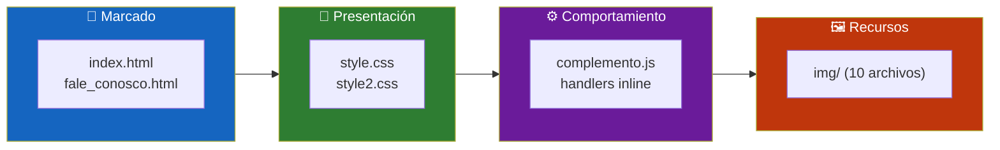
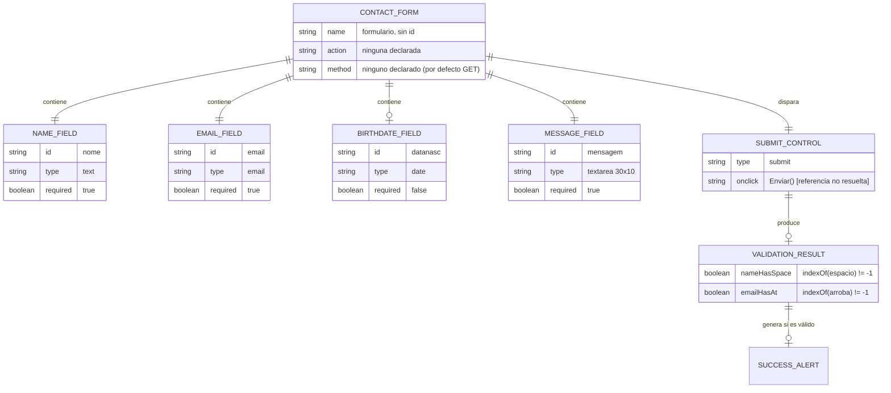
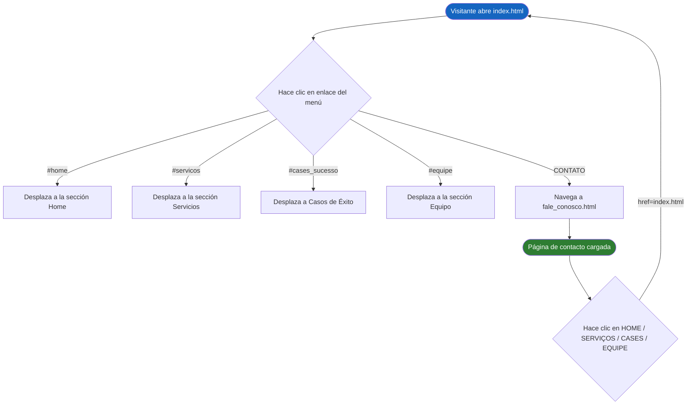
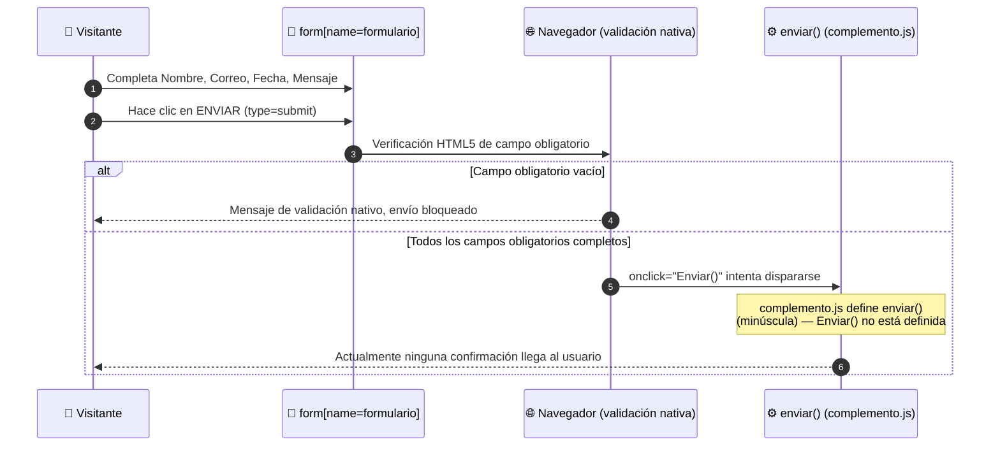
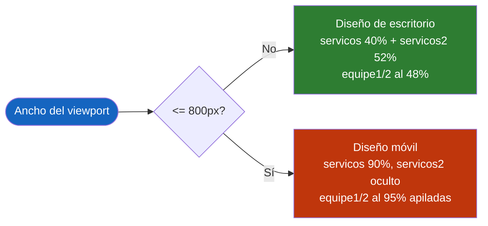
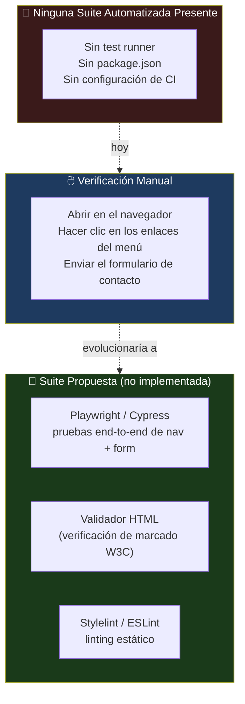

<div align="center">

**🌐 Choose Language / Selecione o Idioma / Elija el Idioma**

[](README.md)&nbsp;&nbsp;&nbsp;[](README_PT.md)&nbsp;&nbsp;&nbsp;[](README_ES.md)

</div>

---

<div align="center">

```
████████╗██████╗  █████╗ ██████╗  █████╗ ██╗     ██╗  ██╗ ██████╗ ███████╗
╚══██╔══╝██╔══██╗██╔══██╗██╔══██╗██╔══██╗██║     ██║  ██║██╔═══██╗██╔════╝
   ██║   ██████╔╝███████║██████╔╝███████║██║     ███████║██║   ██║███████╗
   ██║   ██╔══██╗██╔══██║██╔══██╗██╔══██║██║     ██╔══██║██║   ██║╚════██║
   ██║   ██║  ██║██║  ██║██████╔╝██║  ██║███████╗██║  ██║╚██████╔╝███████║
   ╚═╝   ╚═╝  ╚═╝╚═╝  ╚═╝╚═════╝ ╚═╝  ╚═╝╚══════╝╚═╝  ╚═╝ ╚═════╝ ╚══════╝
          DO-CURSO — Sitio Estático de Trabajo Universitario (HTML/CSS/JS)
```

---

[](https://developer.mozilla.org/docs/Web/HTML)
[](https://developer.mozilla.org/docs/Web/CSS)
[](https://developer.mozilla.org/docs/Web/JavaScript)
[]()
[]()
[]()

<br/>

> **Un sitio estático multipágina, sin dependencias, para una empresa ficticia de seguridad de la información**
> construido como trabajo universitario de desarrollo web, demostrando HTML puro, maquetación CSS y manejo de formularios en JS.

<br/>


</div>

---

## 📑 Tabla de Contenidos

<details>
<summary>▶️ <strong>Haga clic para expandir / contraer esta sección</strong></summary>

<table>
<tr>
<td valign="top" width="50%">

**🏗️ Sistema**
- [Visión General](#-visión-general)
- [Arquitectura del Sistema](#-arquitectura-del-sistema)
- [Stack Tecnológico](#-stack-tecnológico)
- [Patrones de Diseño Aplicados](#-patrones-de-diseño-aplicados)
- [Estructura del Proyecto](#-estructura-del-proyecto)

**📦 Módulos**
- [Encabezado & Navegación](#-encabezado--navegación)
- [Sección Home](#-sección-home)
- [Sección Servicios](#-sección-servicios)
- [Sección Casos de Éxito](#-sección-casos-de-éxito)
- [Sección Equipo](#-sección-equipo)
- [Página de Contacto](#-página-de-contacto)
- [Pie de Página](#-pie-de-página)

</td>
<td valign="top" width="50%">

**💼 Negocio**
- [Reglas de Negocio](#-reglas-de-negocio)
- [Requisitos Funcionales](#-requisitos-funcionales)
- [Requisitos No Funcionales](#-requisitos-no-funcionales)

**📐 Diseño**
- [Modelo de Datos](#-modelo-de-datos)
- [Flujos del Sistema](#-flujos-del-sistema)

**🔐 Seguridad & Operaciones**
- [Seguridad](#-seguridad)
- [Instalación & Ejecución](#-instalación--ejecución)
- [Pruebas Automatizadas](#-pruebas-automatizadas)
- [Métricas & Monitoreo](#-métricas--monitoreo)
- [Limitaciones Conocidas](#-limitaciones-conocidas)

</td>
</tr>
</table>

---

</details>

## 🌟 Visión General

<details>
<summary>▶️ <strong>Haga clic para expandir / contraer esta sección</strong></summary>

**Trabalhos-do-Curso** reúne el trabajo producido en una asignatura de desarrollo web: un sitio estático de dos páginas para **SECURITY HELP**, una consultora ficticia de seguridad de la información. El sitio está escrito a mano en **HTML5**, **CSS3** y **JavaScript puro**, sin framework, bundler, gestor de paquetes ni código de servidor de ningún tipo.

La página principal (`index.html`) es un único documento largo y desplazable, dividido en secciones direccionables por ancla (Home, Servicios, Casos de Éxito, Equipo), accesibles desde una barra de navegación fija. Una segunda página (`fale_conosco.html`) aloja un formulario de contacto con validación simple del lado del cliente. El repositorio también contiene un archivo `trabalho_des_web.zip`, que es el entregable empaquetado presentado para la evaluación, además de tres archivos `new.txt` que marcan carpetas de recursos vacías dentro del árbol versionado.

Dado que el proyecto es trabajo académico, el "negocio" documentado (SECURITY HELP, sus 37 empleados listados, sus testimonios) es contenido ficticio creado para cumplir con un enunciado. Este README trata el proyecto como cualquier otro artefacto de software: la estructura, el estilo y la interactividad son reales y están documentados tal como fueron construidos.

### 🎯 Objetivos del Sistema

| Objetivo | Descripción |
|-----------|-------------|
| 🏠 **Página de Inicio** | Presentar la empresa ficticia en un único `index.html` desplazable |
| 🧭 **Navegación por Ancla** | Permitir que el visitante salte a `#home`, `#servicos`, `#cases_sucesso`, `#equipe` desde un encabezado fijo |
| 🛡️ **Catálogo de Servicios** | Describir cuatro líneas de servicio de seguridad de la información en una lista |
| ⭐ **Prueba Social** | Mostrar cinco testimonios de clientes en "Casos de Éxito" |
| 👥 **Directorio de Equipo** | Listar la plantilla ficticia de personal en dos columnas |
| 📨 **Formulario de Contacto** | Recolectar nombre, correo, fecha de nacimiento y mensaje en `fale_conosco.html` |
| 🎨 **Diseño Responsivo** | Adaptar las columnas de equipo y servicios para pantallas menores a 800px |
| 🔗 **Enlaces Sociales** | Enlazar a Facebook, Instagram y WhatsApp desde el pie de página |

---

</details>

## 🏗️ Arquitectura del Sistema

<details>
<summary>▶️ <strong>Haga clic para expandir / contraer esta sección</strong></summary>

### Diagrama de Módulos

```mermaid
flowchart TB
    subgraph PAGES["📄  PÁGINAS HTML"]
        direction LR
        HOME["🏠 index.html\n─────────────\nHeader + nav\nHome / Servicios\nCasos / Equipo\nPie de página"]
        CONTACT["📨 fale_conosco.html\n─────────────\nHeader + nav\n<form> de contacto\n<script> inline\nPie de página"]
    end

    subgraph STYLE["🎨  PRESENTACIÓN"]
        direction LR
        S1["style.css\n─────────────\nLayout global\nNav · secciones\nMedia query <800px"]
        S2["style2.css\n─────────────\nReglas solo del form\nfale_conosco.html"]
    end

    subgraph SCRIPT["⚙️  COMPORTAMIENTO"]
        JS["complemento.js\n─────────────\nenviar()\nValidación de\nnombre + correo"]
        INLINE["<script> inline\n─────────────\nenviarFormulario()\nform.reset()"]
    end

    subgraph ASSETS["🖼️  RECURSOS ESTÁTICOS"]
        direction LR
        IMG["img/\n─────────────\nlogo · home\nservicos · cases\nequipe1-2\níconos sociales"]
    end

    subgraph DELIV["📦  ENTREGABLE"]
        ZIP["trabalho_des_web.zip\n─────────────\nArchivo presentado\npara evaluación"]
    end

    HOME -->|"href=css/style.css"| S1
    CONTACT -->|"href=css/style.css"| S1
    CONTACT -->|"href=css/style2.css"| S2
    HOME -.->|"etiqueta stylesheet (incorrecta)"| JS
    CONTACT -->|"link text/javascript"| JS
    CONTACT --> INLINE
    HOME --> IMG
    CONTACT --> IMG
    HOME -.->|"empaquetado en"| ZIP
    CONTACT -.->|"empaquetado en"| ZIP

    style PAGES fill:#1e3a5f,color:#fff,stroke:#4a90d9
    style STYLE fill:#1a3a1a,color:#fff,stroke:#4caf50
    style SCRIPT fill:#3a1a1a,color:#fff,stroke:#e57373
    style ASSETS fill:#3a2a1a,color:#fff,stroke:#ffb74d
    style DELIV fill:#2a1a3a,color:#fff,stroke:#ce93d8
```



### Capas de Arquitectura



No existe capa de servidor, base de datos ni paso de build: un navegador solicita `index.html` (o `fale_conosco.html`) directamente de un servidor de archivos, y el documento HTML carga su(s) hoja(s) de estilo y script mediante etiquetas `<link>`/`<script>` simples.

---

</details>

## 🛠️ Stack Tecnológico

<details>
<summary>▶️ <strong>Haga clic para expandir / contraer esta sección</strong></summary>

<table>
<thead>
<tr>
<th>Capa</th>
<th>Tecnología</th>
<th>Versión</th>
<th>Propósito</th>
</tr>
</thead>
<tbody>
<tr>
<td rowspan="1"><strong>📄 Marcado</strong></td>
<td>HTML</td>
<td>5 (<code>&lt;!DOCTYPE html&gt;</code>)</td>
<td><code>index.html</code>, <code>fale_conosco.html</code> — dos documentos escritos a mano</td>
</tr>
<tr>
<td rowspan="2"><strong>🎨 Estilos</strong></td>
<td>CSS</td>
<td>3</td>
<td><code>css/style.css</code> (global) + <code>css/style2.css</code> (página de formulario)</td>
</tr>
<tr>
<td>Media Queries</td>
<td>—</td>
<td><code>@media(max-width:800px)</code> punto de quiebre responsivo</td>
</tr>
<tr>
<td rowspan="2"><strong>⚙️ Scripting</strong></td>
<td>JavaScript</td>
<td>estilo ES5, sin módulos</td>
<td><code>js/complemento.js</code> — verificación de formulario <code>enviar()</code></td>
</tr>
<tr>
<td><code>&lt;script&gt;</code> inline</td>
<td>—</td>
<td><code>fale_conosco.html</code> head — <code>enviarFormulario()</code></td>
</tr>
<tr>
<td rowspan="1"><strong>🖼️ Recursos</strong></td>
<td>PNG / JPG</td>
<td>—</td>
<td>10 archivos en <code>img/</code>: logo, fotos, íconos</td>
</tr>
<tr>
<td rowspan="1"><strong>📦 Empaquetado</strong></td>
<td>Archivo ZIP</td>
<td>—</td>
<td><code>trabalho_des_web.zip</code> — entrega del trabajo calificado</td>
</tr>
<tr>
<td rowspan="1"><strong>🔧 Herramientas</strong></td>
<td>Ninguna</td>
<td>—</td>
<td>No hay gestor de paquetes, bundler, transpilador ni script de build</td>
</tr>
</tbody>
</table>

---

</details>

## 🎨 Patrones de Diseño Aplicados

<details>
<summary>▶️ <strong>Haga clic para expandir / contraer esta sección</strong></summary>

| Patrón | Dónde | Justificación |
|---------|-------|-----------|
| 🧭 **Navegación por Fragmento** | `<a class="menu" href="#servicos">` etc. | Los saltos por ancla en la misma página evitan cargas adicionales para contenido relacionado |
| 🗂️ **Sección-como-Componente** | `<div class="img_home">`, `.img_servicos`, `.img_cases_sucesso`, `.equipe` | Cada bloque visual es un par autocontenido de marcado + clase CSS |
| 🎭 **Wrapper de Imagen de Fondo** | `.img_home`, `.img_servicos`, `.img_cases_sucesso` | Un `div` externo aporta la foto a pantalla completa; un `div` interno contiene el texto legible |
| 📐 **División en Dos Columnas** | `.equipe1` / `.equipe2` (basado en float) | La plantilla de 37 personas se equilibra en dos listas flotantes |
| 📱 **Mejora Progresiva (breakpoint)** | `@media(max-width:800px)` en `style.css` | Las columnas de equipo y servicios colapsan a ancho completo en pantallas pequeñas |
| ✅ **Validación por Cláusula de Guarda** | `enviar()` en `complemento.js` | `if`s anidados rechazan entradas vacías o malformadas antes de alertar éxito |
| 🏷️ **Hitos Semánticos** | `<header>`, `<nav>`, `<footer>` | Elementos nativos de landmark de HTML5 estructuran la página en lugar de `div`s genéricos |

---

</details>

## 📁 Estructura del Proyecto

<details>
<summary>▶️ <strong>Haga clic para expandir / contraer esta sección</strong></summary>

```
Trabalhos-do-Curso/
│
├── 📄 index.html                # Página principal: header/nav + Home, Servicios, Casos, Equipo, pie
├── 📄 fale_conosco.html         # Página de contacto: header/nav + <form> + <script> inline
├── 📄 trabalho_des_web.zip      # Entregable empaquetado presentado para evaluación
├── 📄 .gitignore                # Reglas genéricas de ignore para secretos/artefactos de build
│
├── 📂 css/
│   ├── 📄 style.css             # Layout global: nav, secciones, pie, breakpoint responsivo
│   ├── 📄 style2.css            # Reglas exclusivas del formulario (cargado por fale_conosco.html)
│   └── 📄 new.txt               # Placeholder para mantener la carpeta rastreada en Git
│
├── 📂 js/
│   ├── 📄 complemento.js        # enviar(): validación de nombre + correo en el cliente
│   └── 📄 new.txt               # Placeholder para mantener la carpeta rastreada en Git
│
├── 📂 img/
│   ├── 🖼️ logo.png              # Logo del sitio, usado en el header y el pie
│   ├── 🖼️ home.jpg              # Imagen de fondo de la sección Home
│   ├── 🖼️ servicos.png          # Ilustración junto a la lista de Servicios
│   ├── 🖼️ cases_sucesso.jpg     # Fondo de la sección Casos de Éxito
│   ├── 🖼️ cases1.png            # Imagen de apoyo de caso
│   ├── 🖼️ cases2.jpg            # Imagen de apoyo de caso
│   ├── 🖼️ cases3.jpg            # Imagen de apoyo de caso
│   ├── 🖼️ equipe1.jpg           # Imagen de apoyo de la sección Equipo
│   ├── 🖼️ equipe2.jpg           # Imagen de apoyo de la sección Equipo
│   ├── 🖼️ facebook.png          # Ícono social del pie de página
│   ├── 🖼️ instagram.png         # Ícono social del pie de página
│   ├── 🖼️ whatsapp.png          # Ícono social del pie de página
│   └── 📄 new.txt               # Placeholder para mantener la carpeta rastreada en Git
│
├── 📄 README.md                 # 🇺🇸 English (primary)
├── 📄 README_PT.md              # 🇧🇷 Português
└── 📄 README_ES.md              # 🇪🇸 Español
```

---

</details>

## 📦 Módulos del Sistema

<details>
<summary>▶️ <strong>Haga clic para expandir / contraer esta sección</strong></summary>

### 🧭 Encabezado & Navegación

Presente de forma idéntica en la parte superior de ambas páginas. Un `<header><nav>` envuelve un `div.navegacao` que contiene la imagen del logo y cuatro o cinco enlaces de menú.

| Elemento | `index.html` | `fale_conosco.html` |
|---------|--------------|----------------------|
| Logo | `` | `` |
| HOME | `href="#home"` | `href="index.html"` |
| SERVIÇOS | `href="#servicos"` | `href="index.html"` |
| CASES DE SUCESSO | `href="#cases_sucesso"` | `href="index.html"` |
| EQUIPE | `href="#equipe"` | `href="index.html"` |
| CONTATO | `href="fale_conosco.html"` | `href="#contato"` |

> [!NOTE]
> En `fale_conosco.html`, el enlace CONTATO apunta a `#contato`, pero ningún elemento del archivo tiene `id="contato"` — el ancla actualmente resuelve al inicio de la página.

---

### 🏠 Sección Home

`div.img_home` (fondo a pantalla completa desde `img/home.jpg`, fijo) envuelve `div.home#home`, que contiene un `<h1>APRESENTAÇÃO</h1>` y un párrafo justificado presentando a SECURITY HELP: fundada en Irati-PR, cinco sucursales en Paraná, más de 20 años en el mercado.

---

### 🛠️ Sección Servicios

`div.img_servicos` dispone `div.servicos#servicos` (40% de ancho, inline-block) junto a `div.servicos2` (un panel de imagen posicionado de forma absoluta que muestra `img/servicos.png`). La lista de servicios (`<ul><li>`) enumera cuatro ofertas:

| # | Servicio | Resumen |
|---|---------|---------|
| 1 | Análisis de Vulnerabilidad en TI | Escanea dispositivos/redes en busca de debilidades, usando técnicas como "Pen Test" |
| 2 | Políticas de Seguridad de la Información | Tratamiento conforme a la LGPD, con certificaciones ISO 27001 e ISO 27002 citadas |
| 3 | Recuperación de Datos | Plan de Backup y Continuidad de Negocio: 3 backups en 2 medios diferentes |
| 4 | Capacitación, Certificación y Entrenamiento | Certificación y entrenamiento alineados con la LGPD, ISO 27001/27002 |

---

### ⭐ Sección Casos de Éxito

`div.img_cases_sucesso` (fondo `img/cases_sucesso.jpg`) envuelve `div.cases_sucesso#cases_sucesso`, que contiene un `<h1>` y cinco pares `<h4>`/`<p>` de testimonios de clientes ficticios, además de un párrafo final que afirma más de 350 empresas asociadas.

| Cliente | Dominio |
|--------|--------|
| Banco Socorro | Bancario |
| Ministério Público | Sector público |
| Só Fast, Só Food | Delivery de comida |
| FlashSpeed | Movilidad urbana |
| ChatBook | Mensajería/social |

---

### 👥 Sección Equipo

`div.equipe#equipe` (fondo claro, texto oscuro mediante override inline) contiene un párrafo introductorio seguido de dos listas no ordenadas flotantes, `equipe1` y `equipe2`, cada una con alrededor de 18-19 elementos `<li>` de `Nombre - CARGO`, totalizando **37 empleados nombrados** en roles como Analista de Seguridad, Ingeniero de Redes, Consultor Cibernético. Un párrafo final afirma que la empresa emplea a 100 personas en total.

---

### 📨 Página de Contacto

`fale_conosco.html` reutiliza el mismo header/nav y presenta un `<form name="formulario">` simple (sin `id`, sin `action`, sin `method`) con cuatro campos.

| Campo | Tipo de input | Obligatorio | Notas |
|-------|-----------|----------|-------|
| `nome` | `text` | ✅ | Nombre completo |
| `email` | `email` | ✅ | Verificación nativa del navegador para formato de correo |
| `datanasc` | `date` | — | Fecha de nacimiento, opcional, `id` referenciado pero sin `for` correspondiente en la etiqueta |
| `mensagem` | `textarea` (30×10) | ✅ | Mensaje libre |
| submit | `input[type=submit]` | — | `onclick="Enviar()"` (E mayúscula — no corresponde a ninguna función definida) |

El documento también declara un `<script>` inline con `enviarFormulario()`, que reinicia `#meuFormulario` (un id que el formulario en realidad no posee) y llama a una línea malformada `document.getElementById(...).prompt(...)`. Ni esta función inline ni `Enviar()` (con mayúscula) son invocadas exitosamente por el marcado actual; ver [Limitaciones Conocidas](#-limitaciones-conocidas).

---

### 🦶 Pie de Página

Presente en ambas páginas: un título `<h3>CONTATOS E REDES SOCIAIS</h3>` seguido de `div.rodape` con enlaces de íconos a Facebook, Instagram y WhatsApp, además de un enlace de atribución a Flaticon que envuelve la imagen del logo (satisfaciendo la licencia del ícono).

---

</details>

## 💼 Reglas de Negocio

<details>
<summary>▶️ <strong>Haga clic para expandir / contraer esta sección</strong></summary>

### 📝 Reglas de Contenido

| # | Regla | Aplicación |
|---|------|-------------|
| RN-01 | El sitio presenta exactamente una empresa ficticia, SECURITY HELP | Marca única en ambas páginas, un logo, una paleta de colores |
| RN-02 | Los destinos de navegación en la página principal son anclas de la misma página | `href="#home"`, `#servicos`, `#cases_sucesso`, `#equipe` |
| RN-03 | Los destinos de navegación en la página de contacto apuntan de vuelta a la página principal | `href="index.html"` para HOME/SERVIÇOS/CASES/EQUIPE |
| RN-04 | Cada elemento de servicio nombra una disciplina de seguridad y un párrafo de justificación | Cuatro elementos `<li>` en `#servicos` |
| RN-05 | Cada testimonio se atribuye a un cliente ficticio nombrado | Cinco pares `<h4>`/`<p>` en `#cases_sucesso` |
| RN-06 | La plantilla de equipo se divide en dos columnas visualmente equilibradas | `equipe1` (float:left) / `equipe2` (float:right), ~48% de ancho cada una |

### ✉️ Reglas del Formulario

| # | Regla | Aplicación |
|---|------|-------------|
| RN-07 | Un envío debe incluir un nombre completo que contenga al menos un espacio | `nome.value != "" && nome.value.indexOf(" ") != -1` en `enviar()` |
| RN-08 | Un envío debe incluir el carácter `@` en el campo de correo | `email.value.indexOf("@") != -1` en `enviar()` |
| RN-09 | Los campos nombre y correo están marcados `required` a nivel HTML | El navegador bloquea el envío antes de que corra el JS si están vacíos |
| RN-10 | Una verificación exitosa en el cliente muestra un `alert()` nativo | `alert("ENVIADO COM SUCESSO! Agradecemos a mensagem!")` |

### 📐 Reglas de Diseño

| # | Regla | Aplicación |
|---|------|-------------|
| RN-11 | Por debajo de 800px de ancho de viewport, las secciones multicolumna colapsan a casi ancho completo | `@media(max-width:800px)` en `style.css` |
| RN-12 | La ilustración de servicios se oculta por completo en viewports estrechos | `div.servicos2 { width: 0; height: 0; overflow: hidden; }` dentro del breakpoint |

---

</details>

## ✅ Requisitos Funcionales

<details>
<summary>▶️ <strong>Haga clic para expandir / contraer esta sección</strong></summary>

| ID | Requisito | Prioridad | Estado |
|----|-------------|----------|--------|
| **RF-01** | El sistema debe renderizar una página principal accesible en `index.html` | 🔴 Alta | ✅ Implementado |
| **RF-02** | El sistema debe proveer una barra de navegación fija con logo y enlaces de menú | 🔴 Alta | ✅ Implementado |
| **RF-03** | El sistema debe permitir saltar a la sección Home mediante ancla | 🟡 Media | ✅ Implementado |
| **RF-04** | El sistema debe permitir saltar a la sección Servicios mediante ancla | 🟡 Media | ✅ Implementado |
| **RF-05** | El sistema debe permitir saltar a la sección Casos de Éxito mediante ancla | 🟡 Media | ✅ Implementado |
| **RF-06** | El sistema debe permitir saltar a la sección Equipo mediante ancla | 🟡 Media | ✅ Implementado |
| **RF-07** | El sistema debe listar al menos cuatro ofertas de servicio de seguridad | 🔴 Alta | ✅ Implementado |
| **RF-08** | El sistema debe mostrar al menos cinco testimonios de clientes | 🟡 Media | ✅ Implementado |
| **RF-09** | El sistema debe listar la plantilla de personal en dos columnas | 🟢 Baja | ✅ Implementado |
| **RF-10** | El sistema debe enlazar Facebook, Instagram y WhatsApp en el pie | 🟢 Baja | ✅ Implementado |
| **RF-11** | El sistema debe proveer una página de contacto dedicada con formulario | 🔴 Alta | ✅ Implementado |
| **RF-12** | El formulario de contacto debe recolectar nombre completo, correo, fecha de nacimiento y mensaje | 🔴 Alta | ✅ Implementado |
| **RF-13** | El formulario de contacto debe rechazar el envío de un campo obligatorio vacío a nivel HTML | 🟡 Media | ✅ Implementado |
| **RF-14** | El formulario de contacto debe validar que el nombre contenga un espacio (nombre + apellido) | 🟡 Media | ⚠️ Parcial |
| **RF-15** | El formulario de contacto debe validar que el correo contenga un `@` | 🟡 Media | ⚠️ Parcial |
| **RF-16** | El formulario de contacto debe confirmar el envío exitoso al usuario | 🟡 Media | ⚠️ Parcial |
| **RF-17** | El formulario de contacto debe limpiar sus campos tras un envío exitoso | 🟢 Baja | ⚠️ Parcial |
| **RF-18** | El diseño debe adaptarse a viewports más estrechos que 800px | 🟡 Media | ✅ Implementado |
| **RF-19** | El sistema debe atribuir el conjunto de íconos a su fuente (Flaticon) | 🟢 Baja | ✅ Implementado |
| **RF-20** | El repositorio debe incluir un archivo empaquetado de la entrega | 🟢 Baja | ✅ Implementado |

---

</details>

## ⚡ Requisitos No Funcionales

<details>
<summary>▶️ <strong>Haga clic para expandir / contraer esta sección</strong></summary>

| ID | Categoría | Requisito | Objetivo |
|----|----------|-------------|--------|
| **RNF-01** | ⚡ Rendimiento | Ninguna petición HTTP externa más allá de recursos del mismo origen | Cero llamadas de red a terceros |
| **RNF-02** | 📦 Peso | Peso total de la página, excluyendo el zip | Algunos cientos de KB de imágenes + texto |
| **RNF-03** | 🌐 Compatibilidad | Renderiza en cualquier navegador moderno evergreen | No se requiere CSS con prefijos de fabricante |
| **RNF-04** | 📱 Responsividad | Diseño utilizable hasta un único breakpoint | `@media(max-width:800px)` |
| **RNF-05** | 🎨 Consistencia | Marcado de header/nav/pie idéntico entre páginas | Duplicación manual, mantenida en sincronía a mano |
| **RNF-06** | ♿ Accesibilidad | Las imágenes tienen texto `alt` | Presente pero genérico (`alt="icon"`) en varias imágenes |
| **RNF-07** | 🌍 Internacionalización | Idioma del contenido | Portugués (Brasil), `lang="pt-BR"` en ambos documentos |
| **RNF-08** | 🔧 Mantenibilidad | No se requiere herramienta de build para editar o previsualizar | Abrir el `.html` directamente en el navegador |
| **RNF-09** | 🔐 Privacidad | Sin cookies, analítica ni script de rastreo | Solo marcado estático |
| **RNF-10** | 🧪 Testabilidad | Verificable manualmente en un navegador sin configuración | No hay framework automatizado presente |
| **RNF-11** | 📐 Portabilidad | Sin rutas absolutas, sin dependencia de servidor | `href`/`src` relativos en todas partes |
| **RNF-12** | 🗄️ Versionado | Las carpetas de recursos vacías permanecen rastreadas en Git | Placeholders `new.txt` en `css/`, `js/`, `img/` |

---

</details>

## 🗄️ Modelo de Datos

<details>
<summary>▶️ <strong>Haga clic para expandir / contraer esta sección</strong></summary>

El proyecto no tiene base de datos ni backend; el "modelo de datos" aquí es la forma del **estado del DOM y del payload de formulario en el navegador** con el que operan `complemento.js` y el script inline.

### Diagrama Entidad-Relación



### Forma del Contenido Estático (Plantilla de Equipo / Testimonios)

Como no hay base de datos, el contenido del sitio está en cambio fijado en `index.html` como bloques de marcado repetidos. El "esquema" efectivo que sigue cada entrada es:

| Colección | Forma de la fila | Cantidad |
|------------|-----------|-------|
| Plantilla de equipo (`equipe1`) | Texto `<li>` `Nombre - CARGO_EN_MAYÚSCULAS` | ~19 |
| Plantilla de equipo (`equipe2`) | Texto `<li>` `Nombre - CARGO_EN_MAYÚSCULAS` | ~18 |
| Testimonios | `<h4>Nombre del Cliente</h4>` + `<p>Cita</p>` | 5 |
| Servicios | `<li>TÍTULO: descripción</li>` | 4 |

---

</details>

## 🔄 Flujos del Sistema

<details>
<summary>▶️ <strong>Haga clic para expandir / contraer esta sección</strong></summary>

### Flujo de Navegación entre Páginas



### Flujo de Envío del Formulario de Contacto



> [!NOTE]
> La secuencia anterior documenta el flujo **tal como está codificado**. La diferencia de mayúsculas/minúsculas entre `onclick="Enviar()"` y la función definida `enviar()` hace que la lógica de validación actualmente no se ejecute; ver [Limitaciones Conocidas](#-limitaciones-conocidas).

### Flujo de Diseño Responsivo



---

</details>

## 🔐 Seguridad

<details>
<summary>▶️ <strong>Haga clic para expandir / contraer esta sección</strong></summary>

### Controles Implementados

| Control | Implementación | Efecto |
|---------|---------------|--------|
| ✅ **Atributos HTML5 required** | `required` en `nome`, `email`, `mensagem` | El navegador bloquea el envío vacío antes de que corra cualquier script |
| 📧 **Validación nativa de tipo correo** | `type="email"` en el campo de correo | El navegador impone un formato básico de dirección |
| 🚫 **Sin credenciales inline** | Ninguna clave de API, token o secreto en ninguna parte del código | Nada sensible que filtrar desde una página estática |
| 🔒 **Sin inclusión de scripts externos** | Toda referencia `<script>`/`<link>` es del mismo origen | Ninguna superficie de cadena de suministro de terceros |
| 🧾 **Plantilla de secretos en `.gitignore`** | El `.gitignore` raíz excluye `.env`, `*.pem`, `*.key`, archivos de credenciales | Protege contra commits accidentales de secretos futuros |

### Limitaciones de Seguridad Conocidas

> [!WARNING]
> Este es un sitio estático de trabajo académico, sin backend; los puntos siguientes describen brechas respecto a un formulario de contacto de producción, no explotaciones activas.

| Limitación | Riesgo | Ruta de mitigación |
|------------|------|-----------------|
| 📭 **Sin `action`/`method` en el formulario** | Enviar `fale_conosco.html` actualmente recarga la página con parámetros de consulta en lugar de llegar a un endpoint de servidor | Añadir un `action` real apuntando a un backend o servicio de formularios |
| 🧪 **Validación solo del lado del cliente** | Las verificaciones de `enviar()` son fácilmente eludibles (deshabilitar JS, o hacer POST directamente) | Cualquier despliegue real debe validar nuevamente en el servidor |
| 🪪 **Referencia de función rota** | `onclick="Enviar()"` nunca corresponde a la definición en minúsculas `enviar()` | Corregir las mayúsculas para que la verificación prevista realmente se ejecute |
| 🔗 **Etiqueta de stylesheet mal vinculada al JS** | `index.html` carga `js/complemento.js` mediante `<link rel="stylesheet">` | Debería ser una etiqueta `<script src="js/complemento.js">` |
| 🖊️ **Sin codificación de salida necesaria hoy, pero ninguna definida** | Si el formulario alguna vez se conecta para renderizar contenido enviado, no hay saneamiento vigente | Codificar/escapar cualquier entrada de usuario antes de renderizarla, si se añade un backend |
| 🍪 **Sin token CSRF** | Cualquier futuro endpoint POST aceptaría hoy envíos falsificados | Añadir un token CSRF una vez que exista un backend real |

---

</details>

## 🚀 Instalación & Ejecución

<details>
<summary>▶️ <strong>Haga clic para expandir / contraer esta sección</strong></summary>

### Prerrequisitos

```bash
# Cualquier navegador moderno (Chrome, Firefox, Edge, Safari)
# No se requiere runtime, gestor de paquetes ni herramienta de build.
```

### Compilación

```bash
# No hay paso de compilación. Los archivos HTML/CSS/JS se sirven tal cual.
# Opcionalmente, descomprima el entregable calificado para compararlo con el árbol de trabajo:
unzip trabalho_des_web.zip -d trabalho_des_web_extracted
```

### Ejecución

```bash
# Opción 1 — abrir directamente en el navegador
# Windows:
start index.html
# macOS:
open index.html
# Linux:
xdg-open index.html

# Opción 2 — servir vía HTTP (recomendado, evita peculiaridades de file://)
python -m http.server 8000
# luego navegue a http://localhost:8000/index.html

# Navegue a la página de contacto desde el menú, o directamente:
python -m http.server 8000
# http://localhost:8000/fale_conosco.html
```

### Objetivos / Scripts

| Objetivo | Propósito |
|--------|---------|
| `index.html` | Punto de entrada — página principal con las cuatro secciones de contenido |
| `fale_conosco.html` | Página de contacto con el formulario de validación |
| `python -m http.server` | Servidor estático local sin dependencias |
| `unzip trabalho_des_web.zip` | Inspeccionar el entregable originalmente presentado |

### Configuración de Compilación

| Configuración | Valor | Declarado en |
|---------|-------|-------------|
| Idioma del documento | `pt-BR` | `<html lang="pt-BR">` en ambas páginas |
| Codificación de caracteres | UTF-8 | `<meta charset="UTF-8">` |
| Viewport | `width=device-width, initial-scale=1.0` | `<meta name="viewport">` |
| Orden de carga de CSS (página de contacto) | `style.css` luego `style2.css` | Etiquetas `<link>` en el head de `fale_conosco.html` |

---

</details>

## 🧪 Pruebas Automatizadas

<details>
<summary>▶️ <strong>Haga clic para expandir / contraer esta sección</strong></summary>

### Arquitectura de Pruebas



Este repositorio no incluye **pruebas automatizadas**: no hay `package.json`, test runner ni archivo de flujo de CI. La verificación hoy es manual, en un navegador.

### Ejecutando las Pruebas

```bash
# No hay comando de prueba automatizado. Para verificar manualmente:
python -m http.server 8000
# luego abra http://localhost:8000/index.html y siga la lista de verificación abajo.
```

### Lista de Verificación de Aceptación Manual

| # | Escenario | Resultado esperado |
|---|----------|-----------------|
| 1 | Abrir `index.html` | Header, hero, cuatro secciones y pie de página se renderizan |
| 2 | Hacer clic en HOME/SERVIÇOS/CASES/EQUIPE en el menú | La página se desplaza al ancla `id` correspondiente |
| 3 | Hacer clic en CONTATO | El navegador navega a `fale_conosco.html` |
| 4 | Redimensionar el viewport por debajo de 800px | La imagen de servicios se oculta, las columnas de equipo se apilan |
| 5 | En la página de contacto, enviar con Nome vacío | El navegador muestra el aviso nativo "complete este campo" |
| 6 | Completar Nome con una sola palabra (sin espacio) | La lógica de `enviar()` lo rechazaría, pero actualmente no está conectada para dispararse |
| 7 | Completar Email sin `@` | La verificación nativa `type=email` bloquea el envío primero |
| 8 | Hacer clic en un ícono social del pie de página | Abre Facebook / Instagram / WhatsApp en una nueva pestaña |
| 9 | Inspeccionar el código fuente de la página | Confirma que `js/complemento.js` está enlazado como stylesheet en `index.html` |
| 10 | Ver ambas páginas a 375px de ancho (móvil) | El diseño permanece legible, sin desplazamiento horizontal en el contenido principal |

---

</details>

## 📊 Métricas & Monitoreo

<details>
<summary>▶️ <strong>Haga clic para expandir / contraer esta sección</strong></summary>

### Métricas del Código

| Métrica | Valor |
|--------|-------|
| Archivos HTML | 2 (`index.html`, `fale_conosco.html`) |
| Archivos CSS | 2 (`style.css`, `style2.css`) |
| Archivos JavaScript | 1 (`complemento.js`) + 1 bloque `<script>` inline |
| Recursos de imagen | 10 archivos en `img/` |
| Secciones de contenido (página principal) | 4 (Home, Servicios, Casos, Equipo) |
| Miembros de equipo listados | 37 (19 + 18 en dos columnas) |
| Testimonios | 5 |
| Ofertas de servicio listadas | 4 |
| Breakpoints responsivos | 1 (`800px`) |
| Entregable empaquetado | 1 (`trabalho_des_web.zip`) |

### Señales de Runtime

No hay servidor ni runtime de aplicación; las únicas señales observables están en el propio navegador.

| Señal | Fuente | Dónde observar |
|--------|--------|------------------|
| Errores de consola | Referencia rota `Enviar()`/`enviar()` | DevTools del navegador → Console |
| Falla al cargar recurso | Etiqueta mal escrita `<link rel="stylesheet" href="js/complemento.js">` | DevTools → pestaña Network |
| Avisos de validación nativa | Verificaciones de campo obligatorio / `type=email` | Visible en la página al enviar datos incompletos |
| Peso de la página | Tamaño combinado de HTML/CSS/JS/imágenes | DevTools → Network, total "transferido" |

### Comandos de Diagnóstico Útiles

```bash
# Servir localmente y observar peticiones
python -m http.server 8000
# luego abra DevTools > Network mientras navega

# Validar el marcado según las reglas del W3C (si el validador está instalado)
npx html-validate index.html fale_conosco.html

# Buscar en el repositorio la discrepancia de nombre de función
grep -n "Enviar\|enviar" fale_conosco.html js/complemento.js
```

### Códigos de Estado Estandarizados

Como este es un sitio estático, los "códigos de estado" corresponden a las respuestas HTTP del servidor de archivos, no a un contrato a nivel de aplicación.

| Código | Significado | Cuándo se observa |
|------|---------|----------------|
| `200 OK` | Página o recurso servido con éxito | Cualquier carga normal de página |
| `304 Not Modified` | Recurso en caché reutilizado | Visitas repetidas con la caché del navegador activa |
| `404 Not Found` | Archivo solicitado ausente | Error tipográfico en una ruta `` o `<link href>` |

---

</details>

## ⚠️ Limitaciones Conocidas

<details>
<summary>▶️ <strong>Haga clic para expandir / contraer esta sección</strong></summary>

> [!IMPORTANT]
> Este proyecto fue construido como trabajo universitario de desarrollo web para practicar estructura HTML, maquetación CSS y manejo básico de formularios en JS. No fue construido para despliegue en producción.

| Categoría | Problema | Estado |
|----------|-------|--------|
| 🔗 **Etiqueta de script mal enlazada** | `index.html` incluye `js/complemento.js` mediante `<link rel="stylesheet">` en lugar de `<script src>` | ⚠️ Abierto |
| 🔤 **Discrepancia de mayúsculas en el nombre de la función** | `onclick="Enviar()"` en `fale_conosco.html` nunca coincide con la `enviar()` en minúsculas de `complemento.js` | ⚠️ Abierto |
| 🆔 **Script inline malformado** | `enviarFormulario()` reinicia un `#meuFormulario` inexistente y llama a `.prompt(...)` sobre el retorno de `getElementById(enviarFormulario())`, lo cual es inválido | ⚠️ Abierto |
| 🎯 **Ancla `#contato` sin destino** | El enlace CONTATO en la página de contacto apunta a `#contato`, que no tiene un `id` correspondiente | ⚠️ Abierto |
| 📭 **Sin backend de formulario** | El formulario de contacto no tiene `action`/`method`, por lo que los envíos en realidad no llegan a ningún lado | ⚠️ Abierto |
| 🏷️ **Texto `alt` genérico** | Varias imágenes usan `alt="icon"` en lugar de una descripción específica de esa imagen | ⚠️ Abierto |
| 🌍 **Un solo idioma** | El contenido del sitio es solo en portugués; no existe mecanismo de localización en el propio marcado | ➕ Intencional — alcance de trabajo académico |
| 🧪 **Sin pruebas automatizadas** | No hay test runner ni CI configurados | ⚠️ Abierto |
| 📦 **Header/nav/pie duplicados** | Repetidos a mano en ambos archivos HTML en lugar de usar plantillas | ➕ Intencional — ningún motor de plantillas forma parte del enunciado |
| 🗂️ **Placeholders `new.txt`** | `css/new.txt`, `js/new.txt`, `img/new.txt` existen solo para mantener rastreadas por Git carpetas vacías | ➕ Intencional |

> [!TIP]
> La corrección de mayor valor es resolver la discrepancia `enviar()`/`Enviar()` y conectar `complemento.js` con una etiqueta `<script src="js/complemento.js">` adecuada, ya que ese único cambio hace que la lógica de validación existente se ejecute de verdad por primera vez.

</details>

---

<div align="center">

---

### 🔐 Trabalhos-do-Curso

*Trabajo académico en HTML, CSS y JavaScript puro*

[](https://developer.mozilla.org/docs/Web/HTML)
[](https://developer.mozilla.org/docs/Web/CSS)
[](https://developer.mozilla.org/docs/Web/JavaScript)
[]()

<br/>

```
"Antes del framework, existe la etiqueta.
 Antes de la etiqueta, existe la intención de comunicar."
```

</div>
