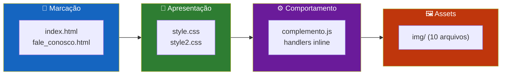
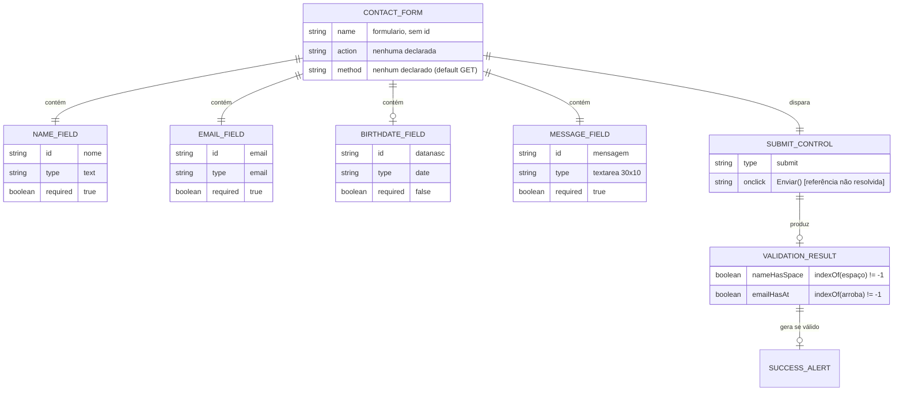
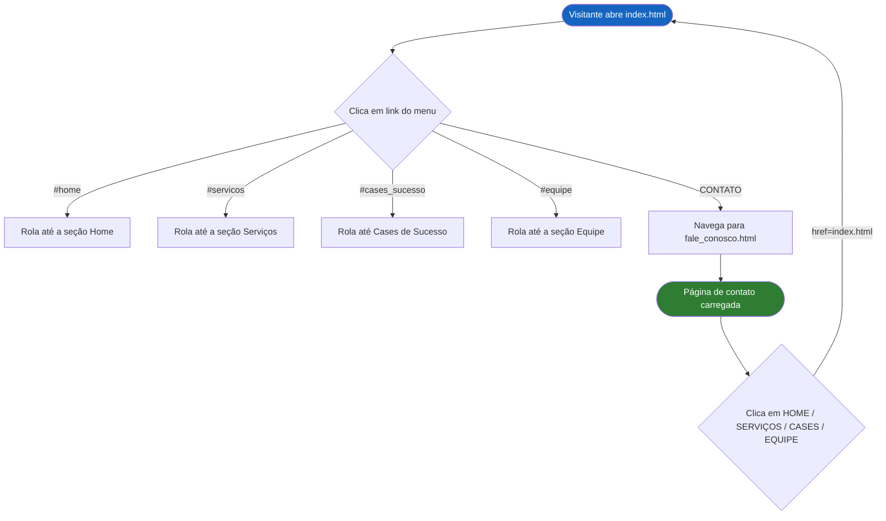
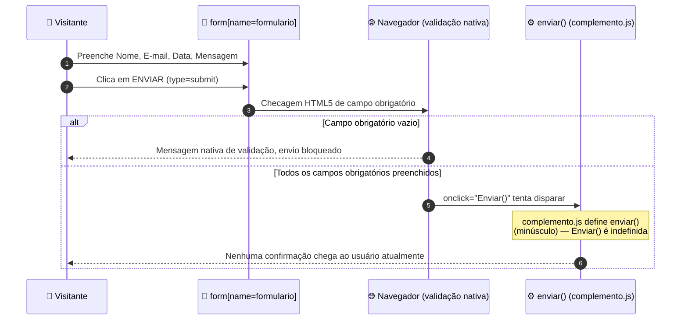
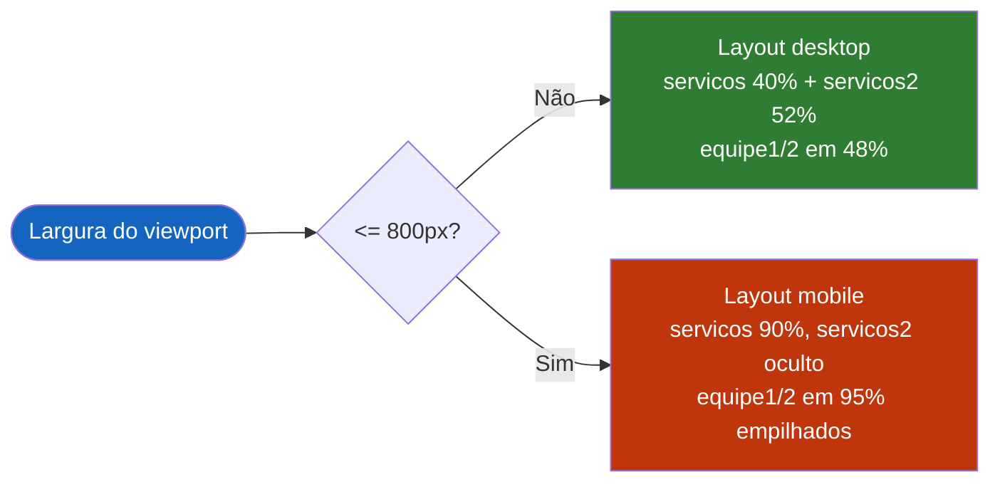
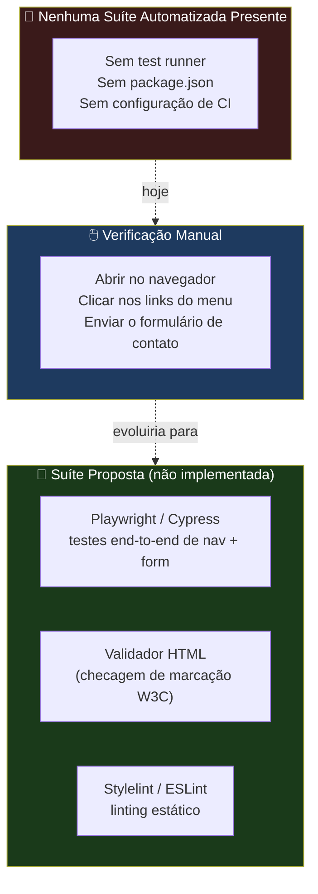

<div align="center">

**🌐 Choose Language / Selecione o Idioma / Elija el Idioma**

[](README.md)&nbsp;&nbsp;&nbsp;[](README_PT.md)&nbsp;&nbsp;&nbsp;[](README_ES.md)

</div>

---

<div align="center">

```
████████╗██████╗  █████╗ ██████╗  █████╗ ██╗     ██╗  ██╗ ██████╗ ███████╗
╚══██╔══╝██╔══██╗██╔══██╗██╔══██╗██╔══██╗██║     ██║  ██║██╔═══██╗██╔════╝
   ██║   ██████╔╝███████║██████╔╝███████║██║     ███████║██║   ██║███████╗
   ██║   ██╔══██╗██╔══██║██╔══██╗██╔══██║██║     ██╔══██║██║   ██║╚════██║
   ██║   ██║  ██║██║  ██║██████╔╝██║  ██║███████╗██║  ██║╚██████╔╝███████║
   ╚═╝   ╚═╝  ╚═╝╚═╝  ╚═╝╚═════╝ ╚═╝  ╚═╝╚══════╝╚═╝  ╚═╝ ╚═════╝ ╚══════╝
           DO-CURSO — Site Estático de Trabalho de Faculdade (HTML/CSS/JS)
```

---

[](https://developer.mozilla.org/docs/Web/HTML)
[](https://developer.mozilla.org/docs/Web/CSS)
[](https://developer.mozilla.org/docs/Web/JavaScript)
[]()
[]()
[]()

<br/>

> **Um site estático multi-página, sem dependências, para uma empresa fictícia de segurança da informação**
> construído como trabalho de faculdade de desenvolvimento web, demonstrando HTML puro, layout CSS e manipulação de formulário em JS.

<br/>


</div>

---

## 📑 Índice

<details>
<summary>▶️ <strong>Clique para expandir / recolher esta seção</strong></summary>

<table>
<tr>
<td valign="top" width="50%">

**🏗️ Sistema**
- [Visão Geral](#-visão-geral)
- [Arquitetura do Sistema](#-arquitetura-do-sistema)
- [Stack Tecnológica](#-stack-tecnológica)
- [Padrões de Projeto Aplicados](#-padrões-de-projeto-aplicados)
- [Estrutura do Projeto](#-estrutura-do-projeto)

**📦 Módulos**
- [Cabeçalho & Navegação](#-cabeçalho--navegação)
- [Seção Home](#-seção-home)
- [Seção Serviços](#-seção-serviços)
- [Seção Cases de Sucesso](#-seção-cases-de-sucesso)
- [Seção Equipe](#-seção-equipe)
- [Página de Contato](#-página-de-contato)
- [Rodapé](#-rodapé)

</td>
<td valign="top" width="50%">

**💼 Negócio**
- [Regras de Negócio](#-regras-de-negócio)
- [Requisitos Funcionais](#-requisitos-funcionais)
- [Requisitos Não Funcionais](#-requisitos-não-funcionais)

**📐 Design**
- [Modelo de Dados](#-modelo-de-dados)
- [Fluxos do Sistema](#-fluxos-do-sistema)

**🔐 Segurança & Operações**
- [Segurança](#-segurança)
- [Instalação & Execução](#-instalação--execução)
- [Testes Automatizados](#-testes-automatizados)
- [Métricas & Monitoramento](#-métricas--monitoramento)
- [Limitações Conhecidas](#-limitações-conhecidas)

</td>
</tr>
</table>

---

</details>

## 🌟 Visão Geral

<details>
<summary>▶️ <strong>Clique para expandir / recolher esta seção</strong></summary>

**Trabalhos-do-Curso** reúne o trabalho produzido em uma disciplina de desenvolvimento web: um site estático de duas páginas para a **SECURITY HELP**, uma consultoria fictícia de segurança da informação. O site é escrito à mão em **HTML5**, **CSS3** e **JavaScript puro**, sem framework, bundler, gerenciador de pacotes ou qualquer código de servidor.

A página inicial (`index.html`) é um único documento longo, rolável, dividido em seções endereçáveis por âncora (Home, Serviços, Cases de Sucesso, Equipe), acessadas a partir de uma barra de navegação fixa. Uma segunda página (`fale_conosco.html`) hospeda um formulário de contato com validação simples no lado do cliente. O repositório também contém um arquivo `trabalho_des_web.zip`, que é o entregável empacotado submetido para avaliação, além de três arquivos `new.txt` que marcam pastas de assets vazias no versionamento.

Como o projeto é um trabalho acadêmico, o "negócio" documentado (SECURITY HELP, seus 37 funcionários listados, seus depoimentos) é conteúdo fictício criado para atender a um enunciado. Este README trata o projeto como qualquer outro artefato de software: a estrutura, a estilização e a interatividade são reais e documentadas como foram construídas.

### 🎯 Objetivos do Sistema

| Objetivo | Descrição |
|-----------|-------------|
| 🏠 **Página Inicial** | Apresentar a empresa fictícia em um único `index.html` rolável |
| 🧭 **Navegação por Âncora** | Permitir que o visitante pule para `#home`, `#servicos`, `#cases_sucesso`, `#equipe` a partir de um cabeçalho fixo |
| 🛡️ **Catálogo de Serviços** | Descrever quatro linhas de serviço de segurança da informação em lista |
| ⭐ **Prova Social** | Exibir cinco depoimentos de clientes em "Cases de Sucesso" |
| 👥 **Diretório de Equipe** | Listar o quadro fictício de funcionários em duas colunas |
| 📨 **Formulário de Contato** | Coletar nome, e-mail, data de nascimento e mensagem em `fale_conosco.html` |
| 🎨 **Layout Responsivo** | Adaptar as colunas de equipe e serviços para telas abaixo de 800px |
| 🔗 **Links Sociais** | Apontar para Facebook, Instagram e WhatsApp no rodapé |

---

</details>

## 🏗️ Arquitetura do Sistema

<details>
<summary>▶️ <strong>Clique para expandir / recolher esta seção</strong></summary>

### Diagrama de Módulos

```mermaid
flowchart TB
    subgraph PAGES["📄  PÁGINAS HTML"]
        direction LR
        HOME["🏠 index.html\n─────────────\nHeader + nav\nHome / Serviços\nCases / Equipe\nRodapé"]
        CONTACT["📨 fale_conosco.html\n─────────────\nHeader + nav\n<form> de contato\n<script> inline\nRodapé"]
    end

    subgraph STYLE["🎨  APRESENTAÇÃO"]
        direction LR
        S1["style.css\n─────────────\nLayout global\nNav · seções\nMedia query <800px"]
        S2["style2.css\n─────────────\nRegras só do form\nfale_conosco.html"]
    end

    subgraph SCRIPT["⚙️  COMPORTAMENTO"]
        JS["complemento.js\n─────────────\nenviar()\nValidação de\nnome + e-mail"]
        INLINE["<script> inline\n─────────────\nenviarFormulario()\nform.reset()"]
    end

    subgraph ASSETS["🖼️  ASSETS ESTÁTICOS"]
        direction LR
        IMG["img/\n─────────────\nlogo · home\nservicos · cases\nequipe1-2\níconos sociais"]
    end

    subgraph DELIV["📦  ENTREGÁVEL"]
        ZIP["trabalho_des_web.zip\n─────────────\nArquivo submetido\npara avaliação"]
    end

    HOME -->|"href=css/style.css"| S1
    CONTACT -->|"href=css/style.css"| S1
    CONTACT -->|"href=css/style2.css"| S2
    HOME -.->|"tag stylesheet (errado)"| JS
    CONTACT -->|"link text/javascript"| JS
    CONTACT --> INLINE
    HOME --> IMG
    CONTACT --> IMG
    HOME -.->|"empacotado em"| ZIP
    CONTACT -.->|"empacotado em"| ZIP

    style PAGES fill:#1e3a5f,color:#fff,stroke:#4a90d9
    style STYLE fill:#1a3a1a,color:#fff,stroke:#4caf50
    style SCRIPT fill:#3a1a1a,color:#fff,stroke:#e57373
    style ASSETS fill:#3a2a1a,color:#fff,stroke:#ffb74d
    style DELIV fill:#2a1a3a,color:#fff,stroke:#ce93d8
```



### Camadas de Arquitetura



Não há camada de servidor, banco de dados nem etapa de build: um navegador solicita `index.html` (ou `fale_conosco.html`) diretamente de um servidor de arquivos, e o documento HTML carrega sua(s) folha(s) de estilo e script via tags `<link>`/`<script>` simples.

---

</details>

## 🛠️ Stack Tecnológica

<details>
<summary>▶️ <strong>Clique para expandir / recolher esta seção</strong></summary>

<table>
<thead>
<tr>
<th>Camada</th>
<th>Tecnologia</th>
<th>Versão</th>
<th>Propósito</th>
</tr>
</thead>
<tbody>
<tr>
<td rowspan="1"><strong>📄 Marcação</strong></td>
<td>HTML</td>
<td>5 (<code>&lt;!DOCTYPE html&gt;</code>)</td>
<td><code>index.html</code>, <code>fale_conosco.html</code> — dois documentos escritos à mão</td>
</tr>
<tr>
<td rowspan="2"><strong>🎨 Estilização</strong></td>
<td>CSS</td>
<td>3</td>
<td><code>css/style.css</code> (global) + <code>css/style2.css</code> (página de formulário)</td>
</tr>
<tr>
<td>Media Queries</td>
<td>—</td>
<td><code>@media(max-width:800px)</code> ponto de quebra responsivo</td>
</tr>
<tr>
<td rowspan="2"><strong>⚙️ Scripting</strong></td>
<td>JavaScript</td>
<td>estilo ES5, sem módulos</td>
<td><code>js/complemento.js</code> — checagem de formulário <code>enviar()</code></td>
</tr>
<tr>
<td><code>&lt;script&gt;</code> inline</td>
<td>—</td>
<td><code>fale_conosco.html</code> head — <code>enviarFormulario()</code></td>
</tr>
<tr>
<td rowspan="1"><strong>🖼️ Assets</strong></td>
<td>PNG / JPG</td>
<td>—</td>
<td>10 arquivos em <code>img/</code>: logo, fotos, ícones</td>
</tr>
<tr>
<td rowspan="1"><strong>📦 Empacotamento</strong></td>
<td>Arquivo ZIP</td>
<td>—</td>
<td><code>trabalho_des_web.zip</code> — entrega do trabalho avaliado</td>
</tr>
<tr>
<td rowspan="1"><strong>🔧 Ferramentas</strong></td>
<td>Nenhuma</td>
<td>—</td>
<td>Não há gerenciador de pacotes, bundler, transpilador ou script de build</td>
</tr>
</tbody>
</table>

---

</details>

## 🎨 Padrões de Projeto Aplicados

<details>
<summary>▶️ <strong>Clique para expandir / recolher esta seção</strong></summary>

| Padrão | Onde | Justificativa |
|---------|-------|-----------|
| 🧭 **Navegação por Fragmento** | `<a class="menu" href="#servicos">` etc. | Saltos por âncora na mesma página evitam carregamentos extras para conteúdo relacionado |
| 🗂️ **Seção-como-Componente** | `<div class="img_home">`, `.img_servicos`, `.img_cases_sucesso`, `.equipe` | Cada bloco visual é um par autocontido de marcação + classe CSS |
| 🎭 **Wrapper de Imagem de Fundo** | `.img_home`, `.img_servicos`, `.img_cases_sucesso` | Uma `div` externa fornece a foto de fundo; uma `div` interna contém o texto legível |
| 📐 **Divisão em Duas Colunas** | `.equipe1` / `.equipe2` (baseado em float) | O quadro de 37 pessoas é balanceado em duas listas flutuantes |
| 📱 **Enriquecimento Progressivo (breakpoint)** | `@media(max-width:800px)` em `style.css` | Colunas de equipe e serviços colapsam para largura total em telas pequenas |
| ✅ **Validação por Cláusula de Guarda** | `enviar()` em `complemento.js` | `if`s aninhados rejeitam entradas vazias ou malformadas antes de alertar sucesso |
| 🏷️ **Marcos Semânticos** | `<header>`, `<nav>`, `<footer>` | Elementos nativos de landmark do HTML5 estruturam a página em vez de `div`s genéricas |

---

</details>

## 📁 Estrutura do Projeto

<details>
<summary>▶️ <strong>Clique para expandir / recolher esta seção</strong></summary>

```
Trabalhos-do-Curso/
│
├── 📄 index.html                # Página inicial: header/nav + Home, Serviços, Cases, Equipe, rodapé
├── 📄 fale_conosco.html         # Página de contato: header/nav + <form> + <script> inline
├── 📄 trabalho_des_web.zip      # Entregável empacotado submetido para avaliação
├── 📄 .gitignore                # Regras genéricas de ignore para segredos/artefatos de build
│
├── 📂 css/
│   ├── 📄 style.css             # Layout global: nav, seções, rodapé, breakpoint responsivo
│   ├── 📄 style2.css            # Regras exclusivas do formulário (carregado por fale_conosco.html)
│   └── 📄 new.txt               # Placeholder para manter a pasta rastreada no Git
│
├── 📂 js/
│   ├── 📄 complemento.js        # enviar(): validação de nome + e-mail no cliente
│   └── 📄 new.txt               # Placeholder para manter a pasta rastreada no Git
│
├── 📂 img/
│   ├── 🖼️ logo.png              # Logo do site, usado no header e no rodapé
│   ├── 🖼️ home.jpg              # Imagem de fundo da seção Home
│   ├── 🖼️ servicos.png          # Ilustração ao lado da lista de Serviços
│   ├── 🖼️ cases_sucesso.jpg     # Fundo da seção Cases de Sucesso
│   ├── 🖼️ cases1.png            # Imagem de apoio de case
│   ├── 🖼️ cases2.jpg            # Imagem de apoio de case
│   ├── 🖼️ cases3.jpg            # Imagem de apoio de case
│   ├── 🖼️ equipe1.jpg           # Imagem de apoio da seção Equipe
│   ├── 🖼️ equipe2.jpg           # Imagem de apoio da seção Equipe
│   ├── 🖼️ facebook.png          # Ícone social do rodapé
│   ├── 🖼️ instagram.png         # Ícone social do rodapé
│   ├── 🖼️ whatsapp.png          # Ícone social do rodapé
│   └── 📄 new.txt               # Placeholder para manter a pasta rastreada no Git
│
├── 📄 README.md                 # 🇺🇸 English (primary)
├── 📄 README_PT.md              # 🇧🇷 Português
└── 📄 README_ES.md              # 🇪🇸 Español
```

---

</details>

## 📦 Módulos do Sistema

<details>
<summary>▶️ <strong>Clique para expandir / recolher esta seção</strong></summary>

### 🧭 Cabeçalho & Navegação

Presente de forma idêntica no topo de ambas as páginas. Um `<header><nav>` envolve uma `div.navegacao` contendo a imagem do logo e quatro ou cinco links de menu.

| Elemento | `index.html` | `fale_conosco.html` |
|---------|--------------|----------------------|
| Logo | `` | `` |
| HOME | `href="#home"` | `href="index.html"` |
| SERVIÇOS | `href="#servicos"` | `href="index.html"` |
| CASES DE SUCESSO | `href="#cases_sucesso"` | `href="index.html"` |
| EQUIPE | `href="#equipe"` | `href="index.html"` |
| CONTATO | `href="fale_conosco.html"` | `href="#contato"` |

> [!NOTE]
> Em `fale_conosco.html`, o link CONTATO aponta para `#contato`, mas nenhum elemento do arquivo possui `id="contato"` — a âncora atualmente resolve para o topo da página.

---

### 🏠 Seção Home

`div.img_home` (fundo de tela cheia a partir de `img/home.jpg`, fixo) envolve `div.home#home`, que contém um `<h1>APRESENTAÇÃO</h1>` e um parágrafo justificado apresentando a SECURITY HELP: fundada em Irati-PR, cinco filiais no Paraná, mais de 20 anos de mercado.

---

### 🛠️ Seção Serviços

`div.img_servicos` dispõe `div.servicos#servicos` (40% de largura, inline-block) ao lado de `div.servicos2` (um painel de imagem posicionado de forma absoluta mostrando `img/servicos.png`). A lista de serviços (`<ul><li>`) enumera quatro ofertas:

| # | Serviço | Resumo |
|---|---------|---------|
| 1 | Análise de Vulnerabilidade em T.I | Varre dispositivos/redes em busca de fraquezas, usando técnicas como "Pen Test" |
| 2 | Políticas de Segurança da Informação | Tratamento conforme LGPD, com certificações ISO 27001 e ISO 27002 citadas |
| 3 | Recuperação de Dados | Plano de Backup e Continuidade de Negócios: 3 backups em 2 mídias diferentes |
| 4 | Capacitação, Certificação e Treinamento | Certificação e treinamento alinhados à LGPD, ISO 27001/27002 |

---

### ⭐ Seção Cases de Sucesso

`div.img_cases_sucesso` (fundo `img/cases_sucesso.jpg`) envolve `div.cases_sucesso#cases_sucesso`, contendo um `<h1>` e cinco pares `<h4>`/`<p>` de depoimentos de clientes fictícios, além de um parágrafo final afirmando mais de 350 empresas parceiras.

| Cliente | Domínio |
|--------|--------|
| Banco Socorro | Bancário |
| Ministério Público | Setor público |
| Só Fast, Só Food | Delivery de comida |
| FlashSpeed | Mobilidade urbana |
| ChatBook | Mensageria/social |

---

### 👥 Seção Equipe

`div.equipe#equipe` (fundo claro, texto escuro via override inline) contém um parágrafo introdutório seguido de duas listas não ordenadas flutuantes, `equipe1` e `equipe2`, cada uma com cerca de 18-19 itens `<li>` de `Nome - CARGO`, totalizando **37 funcionários nomeados** em cargos como Analista de Segurança, Engenheiro de Redes, Consultor Cibernético. Um parágrafo final afirma que a empresa emprega 100 pessoas ao todo.

---

### 📨 Página de Contato

`fale_conosco.html` reutiliza o mesmo header/nav e apresenta um `<form name="formulario">` simples (sem `id`, sem `action`, sem `method`) com quatro campos.

| Campo | Tipo de input | Obrigatório | Notas |
|-------|-----------|----------|-------|
| `nome` | `text` | ✅ | Nome completo |
| `email` | `email` | ✅ | Checagem nativa do navegador para formato de e-mail |
| `datanasc` | `date` | — | Data de nascimento, opcional, `id` referenciado mas sem `for` correspondente no label |
| `mensagem` | `textarea` (30×10) | ✅ | Mensagem livre |
| submit | `input[type=submit]` | — | `onclick="Enviar()"` (E maiúsculo — não corresponde a nenhuma função definida) |

O documento também declara um `<script>` inline com `enviarFormulario()`, que reseta `#meuFormulario` (um id que o formulário não possui de fato) e chama uma linha malformada `document.getElementById(...).prompt(...)`. Nem essa função inline nem `Enviar()` (com maiúscula) são efetivamente invocadas pela marcação atual; ver [Limitações Conhecidas](#-limitações-conhecidas).

---

### 🦶 Rodapé

Presente em ambas as páginas: um título `<h3>CONTATOS E REDES SOCIAIS</h3>` seguido de `div.rodape` com links de ícones para Facebook, Instagram e WhatsApp, além de um link de atribuição ao Flaticon envolvendo a imagem do logo (satisfazendo a licença do ícone).

---

</details>

## 💼 Regras de Negócio

<details>
<summary>▶️ <strong>Clique para expandir / recolher esta seção</strong></summary>

### 📝 Regras de Conteúdo

| # | Regra | Aplicação |
|---|------|-------------|
| RN-01 | O site apresenta exatamente uma empresa fictícia, SECURITY HELP | Marca única em ambas as páginas, um logo, uma paleta de cores |
| RN-02 | Os destinos de navegação na página inicial são âncoras da mesma página | `href="#home"`, `#servicos`, `#cases_sucesso`, `#equipe` |
| RN-03 | Os destinos de navegação na página de contato apontam de volta para a página inicial | `href="index.html"` para HOME/SERVIÇOS/CASES/EQUIPE |
| RN-04 | Cada item de serviço nomeia uma disciplina de segurança e um parágrafo de justificativa | Quatro itens `<li>` em `#servicos` |
| RN-05 | Cada depoimento é atribuído a um cliente fictício nomeado | Cinco pares `<h4>`/`<p>` em `#cases_sucesso` |
| RN-06 | O quadro de equipe é dividido em duas colunas visualmente balanceadas | `equipe1` (float:left) / `equipe2` (float:right), ~48% de largura cada |

### ✉️ Regras do Formulário

| # | Regra | Aplicação |
|---|------|-------------|
| RN-07 | Um envio deve incluir um nome completo contendo ao menos um espaço | `nome.value != "" && nome.value.indexOf(" ") != -1` em `enviar()` |
| RN-08 | Um envio deve incluir o caractere `@` no campo de e-mail | `email.value.indexOf("@") != -1` em `enviar()` |
| RN-09 | Os campos nome e e-mail são marcados `required` no nível HTML | Navegador bloqueia envio antes do JS rodar se estiverem vazios |
| RN-10 | Uma checagem bem-sucedida no cliente exibe um `alert()` nativo | `alert("ENVIADO COM SUCESSO! Agradecemos a mensagem!")` |

### 📐 Regras de Layout

| # | Regra | Aplicação |
|---|------|-------------|
| RN-11 | Abaixo de 800px de largura de viewport, seções multi-coluna colapsam para quase largura total | `@media(max-width:800px)` em `style.css` |
| RN-12 | A ilustração de serviços é totalmente ocultada em viewports estreitos | `div.servicos2 { width: 0; height: 0; overflow: hidden; }` dentro do breakpoint |

---

</details>

## ✅ Requisitos Funcionais

<details>
<summary>▶️ <strong>Clique para expandir / recolher esta seção</strong></summary>

| ID | Requisito | Prioridade | Status |
|----|-------------|----------|--------|
| **RF-01** | O sistema deve renderizar uma página inicial acessível em `index.html` | 🔴 Alta | ✅ Implementado |
| **RF-02** | O sistema deve fornecer uma barra de navegação fixa com logo e links de menu | 🔴 Alta | ✅ Implementado |
| **RF-03** | O sistema deve permitir pular para a seção Home via âncora | 🟡 Média | ✅ Implementado |
| **RF-04** | O sistema deve permitir pular para a seção Serviços via âncora | 🟡 Média | ✅ Implementado |
| **RF-05** | O sistema deve permitir pular para a seção Cases de Sucesso via âncora | 🟡 Média | ✅ Implementado |
| **RF-06** | O sistema deve permitir pular para a seção Equipe via âncora | 🟡 Média | ✅ Implementado |
| **RF-07** | O sistema deve listar pelo menos quatro ofertas de serviço de segurança | 🔴 Alta | ✅ Implementado |
| **RF-08** | O sistema deve exibir pelo menos cinco depoimentos de clientes | 🟡 Média | ✅ Implementado |
| **RF-09** | O sistema deve listar o quadro de funcionários em duas colunas | 🟢 Baixa | ✅ Implementado |
| **RF-10** | O sistema deve linkar Facebook, Instagram e WhatsApp no rodapé | 🟢 Baixa | ✅ Implementado |
| **RF-11** | O sistema deve fornecer uma página de contato dedicada com formulário | 🔴 Alta | ✅ Implementado |
| **RF-12** | O formulário de contato deve coletar nome completo, e-mail, data de nascimento e mensagem | 🔴 Alta | ✅ Implementado |
| **RF-13** | O formulário de contato deve rejeitar envio de campo obrigatório vazio no nível HTML | 🟡 Média | ✅ Implementado |
| **RF-14** | O formulário de contato deve validar que o nome contém um espaço (nome + sobrenome) | 🟡 Média | ⚠️ Parcial |
| **RF-15** | O formulário de contato deve validar que o e-mail contém um `@` | 🟡 Média | ⚠️ Parcial |
| **RF-16** | O formulário de contato deve confirmar o envio bem-sucedido ao usuário | 🟡 Média | ⚠️ Parcial |
| **RF-17** | O formulário de contato deve limpar seus campos após um envio bem-sucedido | 🟢 Baixa | ⚠️ Parcial |
| **RF-18** | O layout deve se adaptar a viewports mais estreitos que 800px | 🟡 Média | ✅ Implementado |
| **RF-19** | O sistema deve atribuir o conjunto de ícones à sua fonte (Flaticon) | 🟢 Baixa | ✅ Implementado |
| **RF-20** | O repositório deve incluir um arquivo empacotado de submissão | 🟢 Baixa | ✅ Implementado |

---

</details>

## ⚡ Requisitos Não Funcionais

<details>
<summary>▶️ <strong>Clique para expandir / recolher esta seção</strong></summary>

| ID | Categoria | Requisito | Alvo |
|----|----------|-------------|--------|
| **RNF-01** | ⚡ Performance | Nenhuma requisição HTTP externa além de assets do mesmo domínio | Zero chamadas de rede a terceiros |
| **RNF-02** | 📦 Footprint | Peso total da página, excluindo o zip | Algumas centenas de KB de imagens + texto |
| **RNF-03** | 🌐 Compatibilidade | Renderiza em qualquer navegador moderno evergreen | Nenhum CSS com prefixo de fabricante necessário |
| **RNF-04** | 📱 Responsividade | Layout utilizável até um único breakpoint | `@media(max-width:800px)` |
| **RNF-05** | 🎨 Consistência | Marcação de header/nav/rodapé idêntica entre páginas | Duplicação manual, mantida em sincronia à mão |
| **RNF-06** | ♿ Acessibilidade | Imagens possuem texto `alt` | Presente, mas genérico (`alt="icon"`) em várias imagens |
| **RNF-07** | 🌍 Internacionalização | Idioma do conteúdo | Português (Brasil), `lang="pt-BR"` em ambos os documentos |
| **RNF-08** | 🔧 Manutenibilidade | Nenhuma ferramenta de build necessária para editar ou pré-visualizar | Abrir o `.html` diretamente no navegador |
| **RNF-09** | 🔐 Privacidade | Nenhum cookie, analytics ou script de rastreamento | Somente marcação estática |
| **RNF-10** | 🧪 Testabilidade | Verificável manualmente em um navegador sem configuração | Nenhum framework automatizado presente |
| **RNF-11** | 📐 Portabilidade | Nenhum caminho absoluto, sem dependência de servidor | `href`/`src` relativos em toda parte |
| **RNF-12** | 🗄️ Versionamento | Pastas de assets vazias permanecem rastreadas no Git | Placeholders `new.txt` em `css/`, `js/`, `img/` |

---

</details>

## 🗄️ Modelo de Dados

<details>
<summary>▶️ <strong>Clique para expandir / recolher esta seção</strong></summary>

O projeto não possui banco de dados ou backend; o "modelo de dados" aqui é a forma do **estado do DOM e do payload de formulário no navegador** com o qual `complemento.js` e o script inline operam.

### Diagrama Entidade-Relacionamento



### Forma do Conteúdo Estático (Quadro de Equipe / Depoimentos)

Como não há banco de dados, o conteúdo do site é, em vez disso, fixado em `index.html` como blocos de marcação repetidos. O "schema" efetivo que cada entrada segue é:

| Coleção | Formato da linha | Contagem |
|------------|-----------|-------|
| Quadro de equipe (`equipe1`) | Texto `<li>` `Nome - CARGO_EM_MAIÚSCULAS` | ~19 |
| Quadro de equipe (`equipe2`) | Texto `<li>` `Nome - CARGO_EM_MAIÚSCULAS` | ~18 |
| Depoimentos | `<h4>Nome do Cliente</h4>` + `<p>Citação</p>` | 5 |
| Serviços | `<li>TÍTULO: descrição</li>` | 4 |

---

</details>

## 🔄 Fluxos do Sistema

<details>
<summary>▶️ <strong>Clique para expandir / recolher esta seção</strong></summary>

### Fluxo de Navegação entre Páginas



### Fluxo de Envio do Formulário de Contato



> [!NOTE]
> A sequência acima documenta o fluxo **como codificado**. A diferença de maiúsculas/minúsculas entre `onclick="Enviar()"` e a função definida `enviar()` faz com que a lógica de validação atualmente não seja executada; ver [Limitações Conhecidas](#-limitações-conhecidas).

### Fluxo de Layout Responsivo



---

</details>

## 🔐 Segurança

<details>
<summary>▶️ <strong>Clique para expandir / recolher esta seção</strong></summary>

### Controles Implementados

| Controle | Implementação | Efeito |
|---------|---------------|--------|
| ✅ **Atributos HTML5 required** | `required` em `nome`, `email`, `mensagem` | Navegador bloqueia envio vazio antes de qualquer script rodar |
| 📧 **Validação nativa de tipo e-mail** | `type="email"` no campo de e-mail | Navegador impõe um formato básico de endereço |
| 🚫 **Sem credenciais inline** | Nenhuma chave de API, token ou segredo em qualquer lugar do código | Nada sensível a vazar de uma página estática |
| 🔒 **Sem inclusão de scripts externos** | Toda referência `<script>`/`<link>` é do mesmo domínio | Nenhuma superfície de cadeia de suprimentos de terceiros |
| 🧾 **Template de segredos no `.gitignore`** | O `.gitignore` raiz exclui `.env`, `*.pem`, `*.key`, arquivos de credenciais | Protege contra commits acidentais de segredos futuros |

### Limitações de Segurança Conhecidas

> [!WARNING]
> Este é um site estático de trabalho acadêmico, sem backend; os itens abaixo descrevem lacunas em relação a um formulário de contato de produção, não explorações ativas.

| Limitação | Risco | Caminho de mitigação |
|------------|------|-----------------|
| 📭 **Sem `action`/`method` no formulário** | Enviar `fale_conosco.html` atualmente recarrega a página com query params em vez de atingir um endpoint de servidor | Adicionar um `action` real apontando para um backend ou serviço de formulário |
| 🧪 **Validação apenas no cliente** | As checagens de `enviar()` são trivialmente contornáveis (desabilitar JS, ou fazer POST diretamente) | Qualquer deploy real deve validar novamente no servidor |
| 🪪 **Referência de função quebrada** | `onclick="Enviar()"` nunca corresponde à definição em minúsculas `enviar()` | Corrigir a capitalização para que a checagem pretendida realmente rode |
| 🔗 **Tag de stylesheet incorretamente ligada ao JS** | `index.html` carrega `js/complemento.js` via `<link rel="stylesheet">` | Deveria ser uma tag `<script src="js/complemento.js">` |
| 🖊️ **Sem codificação de saída necessária hoje, mas nenhuma definida** | Se o formulário for algum dia conectado para renderizar conteúdo enviado de volta, não há sanitização em vigor | Codificar/escapar qualquer entrada do usuário antes de renderizá-la, caso um backend seja adicionado |
| 🍪 **Sem token CSRF** | Qualquer futuro endpoint POST aceitaria hoje envios forjados | Adicionar um token CSRF assim que um backend real existir |

---

</details>

## 🚀 Instalação & Execução

<details>
<summary>▶️ <strong>Clique para expandir / recolher esta seção</strong></summary>

### Pré-requisitos

```bash
# Qualquer navegador moderno (Chrome, Firefox, Edge, Safari)
# Nenhum runtime, gerenciador de pacotes ou ferramenta de build é necessário.
```

### Build

```bash
# Não há etapa de build. Os arquivos HTML/CSS/JS são servidos como estão.
# Opcionalmente, descompacte o entregável avaliado para comparar com o repositório:
unzip trabalho_des_web.zip -d trabalho_des_web_extracted
```

### Execução

```bash
# Opção 1 — abrir diretamente no navegador
# Windows:
start index.html
# macOS:
open index.html
# Linux:
xdg-open index.html

# Opção 2 — servir via HTTP (recomendado, evita peculiaridades do file://)
python -m http.server 8000
# depois navegue para http://localhost:8000/index.html

# Navegue até a página de contato pelo menu, ou diretamente:
python -m http.server 8000
# http://localhost:8000/fale_conosco.html
```

### Alvos / Scripts

| Alvo | Propósito |
|--------|---------|
| `index.html` | Ponto de entrada — página inicial com as quatro seções de conteúdo |
| `fale_conosco.html` | Página de contato com o formulário de validação |
| `python -m http.server` | Servidor estático local sem dependências |
| `unzip trabalho_des_web.zip` | Inspecionar o entregável originalmente submetido |

### Configuração de Build

| Configuração | Valor | Declarado em |
|---------|-------|-------------|
| Idioma do documento | `pt-BR` | `<html lang="pt-BR">` em ambas as páginas |
| Codificação de caracteres | UTF-8 | `<meta charset="UTF-8">` |
| Viewport | `width=device-width, initial-scale=1.0` | `<meta name="viewport">` |
| Ordem de carregamento de CSS (página de contato) | `style.css` depois `style2.css` | Tags `<link>` no head de `fale_conosco.html` |

---

</details>

## 🧪 Testes Automatizados

<details>
<summary>▶️ <strong>Clique para expandir / recolher esta seção</strong></summary>

### Arquitetura de Testes



Este repositório não possui **testes automatizados**: não há `package.json`, test runner ou arquivo de workflow de CI. A verificação hoje é manual, no navegador.

### Executando os Testes

```bash
# Não há comando de teste automatizado. Para verificar manualmente:
python -m http.server 8000
# depois abra http://localhost:8000/index.html e siga a checklist abaixo.
```

### Checklist de Aceitação Manual

| # | Cenário | Resultado esperado |
|---|----------|-----------------|
| 1 | Abrir `index.html` | Header, hero, quatro seções e rodapé renderizam |
| 2 | Clicar em HOME/SERVIÇOS/CASES/EQUIPE no menu | Página rola até a âncora `id` correspondente |
| 3 | Clicar em CONTATO | Navegador navega para `fale_conosco.html` |
| 4 | Redimensionar viewport abaixo de 800px | Imagem de serviços some, colunas de equipe empilham |
| 5 | Na página de contato, enviar com Nome vazio | Navegador mostra prompt nativo "preencha este campo" |
| 6 | Preencher Nome com uma única palavra (sem espaço) | A lógica de `enviar()` rejeitaria, mas não está conectada para disparar atualmente |
| 7 | Preencher Email sem `@` | A checagem nativa `type=email` bloqueia o envio primeiro |
| 8 | Clicar em um ícone social do rodapé | Abre Facebook / Instagram / WhatsApp em nova aba |
| 9 | Inspecionar o código-fonte da página | Confirma que `js/complemento.js` é linkado como stylesheet em `index.html` |
| 10 | Ver ambas as páginas em 375px de largura (mobile) | Layout permanece legível, sem rolagem horizontal no conteúdo principal |

---

</details>

## 📊 Métricas & Monitoramento

<details>
<summary>▶️ <strong>Clique para expandir / recolher esta seção</strong></summary>

### Métricas de Código

| Métrica | Valor |
|--------|-------|
| Arquivos HTML | 2 (`index.html`, `fale_conosco.html`) |
| Arquivos CSS | 2 (`style.css`, `style2.css`) |
| Arquivos JavaScript | 1 (`complemento.js`) + 1 bloco `<script>` inline |
| Assets de imagem | 10 arquivos em `img/` |
| Seções de conteúdo (página inicial) | 4 (Home, Serviços, Cases, Equipe) |
| Membros de equipe listados | 37 (19 + 18 em duas colunas) |
| Depoimentos | 5 |
| Ofertas de serviço listadas | 4 |
| Breakpoints responsivos | 1 (`800px`) |
| Entregável empacotado | 1 (`trabalho_des_web.zip`) |

### Sinais de Runtime

Não há servidor ou runtime de aplicação; os únicos sinais observáveis estão no próprio navegador.

| Sinal | Fonte | Onde observar |
|--------|--------|------------------|
| Erros de console | Referência quebrada `Enviar()`/`enviar()` | DevTools do navegador → Console |
| Falha ao carregar recurso | Tag mal escrita `<link rel="stylesheet" href="js/complemento.js">` | DevTools → aba Network |
| Prompts de validação nativa | Checagens de campo obrigatório / `type=email` | Visível na página ao enviar dados incompletos |
| Peso da página | Tamanho combinado de HTML/CSS/JS/imagens | DevTools → Network, total "transferido" |

### Comandos de Diagnóstico Úteis

```bash
# Servir localmente e observar requisições
python -m http.server 8000
# depois abra o DevTools > Network enquanto navega

# Validar marcação com as regras do W3C (se o validador estiver instalado)
npx html-validate index.html fale_conosco.html

# Buscar no repositório a diferença de nome de função
grep -n "Enviar\|enviar" fale_conosco.html js/complemento.js
```

### Códigos de Status Padronizados

Como este é um site estático, "códigos de status" mapeiam para as respostas HTTP do servidor de arquivos, e não para um contrato de nível de aplicação.

| Código | Significado | Quando observado |
|------|---------|----------------|
| `200 OK` | Página ou asset servido com sucesso | Qualquer carregamento normal de página |
| `304 Not Modified` | Asset em cache reutilizado | Visitas repetidas com cache do navegador aquecido |
| `404 Not Found` | Arquivo solicitado ausente | Erro de digitação em um caminho `` ou `<link href>` |

---

</details>

## ⚠️ Limitações Conhecidas

<details>
<summary>▶️ <strong>Clique para expandir / recolher esta seção</strong></summary>

> [!IMPORTANT]
> Este projeto foi construído como trabalho de faculdade de desenvolvimento web para praticar estrutura HTML, layout CSS e manipulação básica de formulário em JS. Não foi construído para deploy em produção.

| Categoria | Problema | Status |
|----------|-------|--------|
| 🔗 **Tag de script mal ligada** | `index.html` inclui `js/complemento.js` via `<link rel="stylesheet">` em vez de `<script src>` | ⚠️ Aberto |
| 🔤 **Divergência de maiúsculas no nome da função** | `onclick="Enviar()"` em `fale_conosco.html` nunca corresponde à `enviar()` minúscula em `complemento.js` | ⚠️ Aberto |
| 🆔 **Script inline malformado** | `enviarFormulario()` reseta um `#meuFormulario` inexistente e chama `.prompt(...)` no retorno de `getElementById(enviarFormulario())`, o que é inválido | ⚠️ Aberto |
| 🎯 **Âncora `#contato` sem destino** | O link CONTATO na página de contato aponta para `#contato`, que não possui `id` correspondente | ⚠️ Aberto |
| 📭 **Sem backend de formulário** | O formulário de contato não tem `action`/`method`, então os envios não são de fato enviados a lugar nenhum | ⚠️ Aberto |
| 🏷️ **Texto `alt` genérico** | Várias imagens usam `alt="icon"` em vez de uma descrição específica daquela imagem | ⚠️ Aberto |
| 🌍 **Apenas um idioma** | O conteúdo do site é somente em português; não há mecanismo de localização na própria marcação | ➕ Intencional — escopo de trabalho acadêmico |
| 🧪 **Sem testes automatizados** | Nenhum test runner ou CI configurado | ⚠️ Aberto |
| 📦 **Header/nav/rodapé duplicados** | Repetidos à mão em ambos os arquivos HTML em vez de templatizados | ➕ Intencional — nenhum motor de templates faz parte do enunciado |
| 🗂️ **Placeholders `new.txt`** | `css/new.txt`, `js/new.txt`, `img/new.txt` existem apenas para manter pastas vazias rastreadas pelo Git | ➕ Intencional |

> [!TIP]
> A correção de maior valor é resolver a divergência `enviar()`/`Enviar()` e conectar `complemento.js` com uma tag `<script src="js/complemento.js">` adequada, já que essa única mudança faz a lógica de validação existente rodar de verdade pela primeira vez.

</details>

---

<div align="center">

---

### 🔐 Trabalhos-do-Curso

*Trabalho acadêmico em HTML, CSS e JavaScript puro*

[](https://developer.mozilla.org/docs/Web/HTML)
[](https://developer.mozilla.org/docs/Web/CSS)
[](https://developer.mozilla.org/docs/Web/JavaScript)
[]()

<br/>

```
"Antes do framework, existe a tag.
 Antes da tag, existe a intenção de comunicar."
```

</div>
